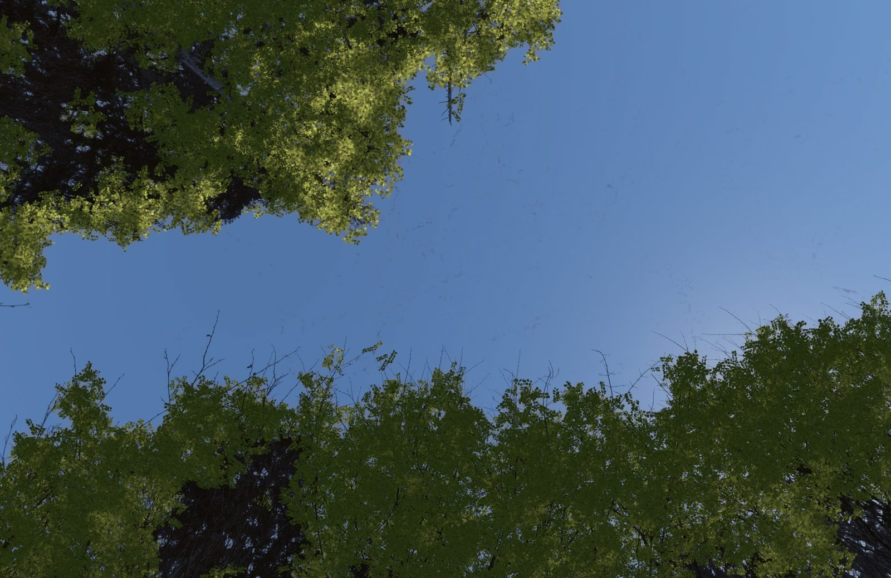
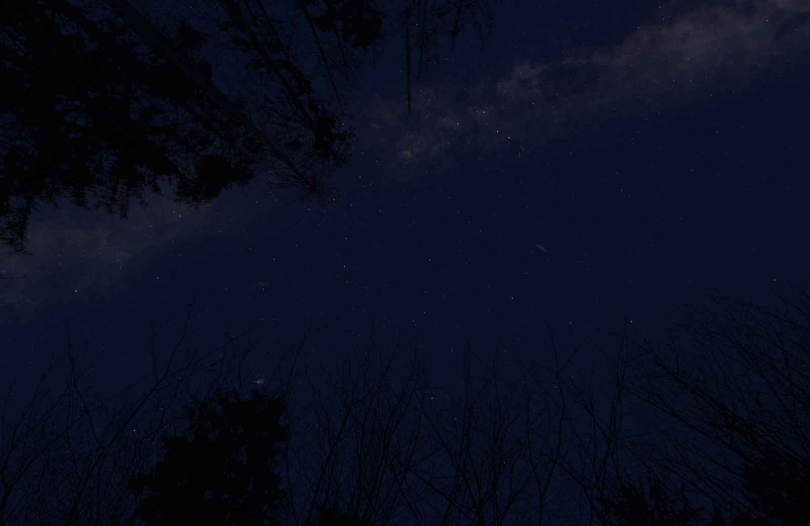
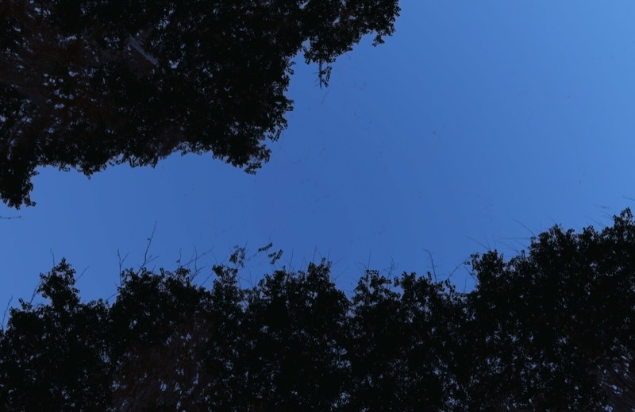
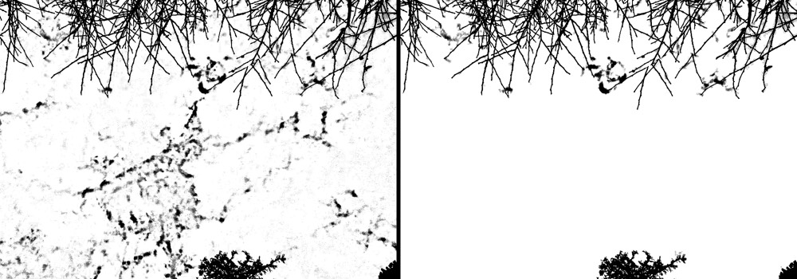
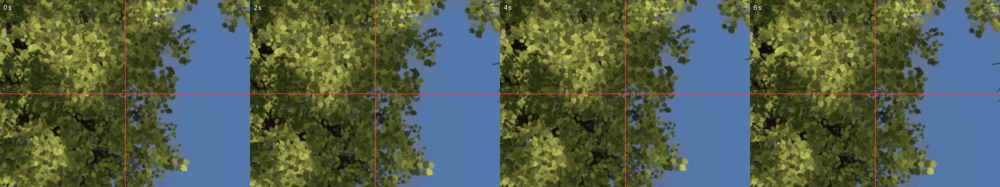

# Canopy

Lying on the forest floor, looking straight up: crowns sway against the sky with channels of light between them, stars show through the gaps at night, and the leaves turn and thin in autumn.

It was pick #3 of the "Atrium Wallpaper Ideas" page of 2026-11-14 (a review of the catalogue by the session atrium-37), in these words: "Lying on the forest floor, looking straight up. Crowns sway against the sky with channels of light between them. Stars show through the gaps at night, and the leaves turn and thin in autumn." What is real: "Live wind, Weather's sky and cloud, the real star catalogue, and your season from the date and latitude." Builds on: "Dappled Light's scanned leaves, Weather's sky and Live Sky's stars, in the looking-up view that worked for Kelp Forest. It could use A Tree for the Year's bark and branches." Risk, medium: "Dark leaves on a bright sky are high contrast, so the daytime look needs softening." Dave ran `/new-wallpaper` on it on 2026-11-16.

- **Research:** [canopy/research-method.md](canopy/research-method.md) (camera, numbers, three ways to draw the crowns, measured cost) and [canopy/research-look.md](canopy/research-look.md) (references, palettes, brightness, CC0 assets, the name).
- **Scripts:** `docs/canopy/mock.swift` (SKRenderer, the app's `Atmosphere` through a zenith camera), `variants.py`, `sheet.py`; [canopy/mockups-round1.md](canopy/mockups-round1.md) has every tile's measurements, assets and licences, and how to redraw a round.
- **Where it stands (2026-11-18):** step (a), the still picture, the first part of step (d), the night and the light kept current (d1), and step (b), motion (the sway in a breeze, the flutter, falling leaves, the battery rate), built and hidden behind `unfinished` (`Sources/Atrium/Canopy.swift`), with the twilight's colour and the stand's matte put right; (b)'s sway redone from footage (b2: the wood still, the twigs and leaves rustling, the nearest leaves moving over the rest), Model 2 of the films Dave chose from ([canopy/motion-round.md](canopy/motion-round.md)), locked in with the other two cut; steps (c), the rest of (d) (the live wind among it) and (e) to come.

## What the idea's author meant (atrium-37, 2026-11-16)
Asked on Dave's word, the session that wrote the ideas page said:
- **The view:** a ring of crowns closing in from the screen's edges, with channels of sky between them (as crown shyness leaves), not one tree overhead: one tree as the subject is what sank A Tree for the Year. Sky about a quarter to a third of the screen by day, more in winter as the broadleaves thin. A birch or aspen grove gives the classic shot of pale trunks running in from the edges toward the zenith; evergreens stay as dark masses at the rim, so winter keeps a frame.
- **The leaves backlit and translucent:** looking up at a sunlit crown, leaves glow yellow-green by the light through them, shade leaves deeper green, and only those against bright sky near the Sun go dark. From Dappled Light, only the leaf shapes (the maple, oak and beech atlas) and its clumps carry over; its shading is shadows on a wall.
- **Not A Tree for the Year's code** (cut in ed079db, so at `ed079db^`): its leaves read as paper cards beside photos, and would here. Reuse `Phenology` (still in the app) for the seasons. Photos over procedural: trunks as bark scans on tapered, foreshortened columns, crowns as cut-outs of openly licensed looking-up photos swayed by displacement (licences unchecked).
- **Softening the day**, most effective first: the light through the leaves, so they glow rather than go black; small gaps of sky held to the deep blue of the zenith; a soft veiling glow where sky meets leaf; the Sun behind a crown by default. Held to brightness caps from the start, not an overcast default.
- **From Kelp Forest's doc:** its looking-up view came out too bright (median 192) and took an exposure of 0.42, which greyed its window; it was its costliest view; a uniform set marks every sprite using the shader (set them only when they change); per-sprite shader attributes crashed the lock screen's still (ride data in the sprite's colour); pose nothing off the screen; drawn blades read drawn up close, so photo cards for anything near; foliage came out paler than the light behind it until darkened; a branch snapped in across the view looking up (fixed in b805c6a), so watch near crowns entering the frame.

## Dave's decisions (2026-11-16, before research)
- **Its own wallpaper**, not a "Looking up" view in Dappled Light or a foreground on Weather. It borrows their code (Dappled Light's leaf scans, Weather's sky, Night Sky's stars), not a place in their Settings.
- **Forests:** broadleaf (maple, oak, beech, as Dappled Light's leaf scans already are) and a birch or aspen grove. Not redwood or pine as a forest of its own, and not tropical crown shyness.
- **Winter:** the real season from the date and latitude, with a few evergreens in the ring of crowns so it is never all bare: the broadleaf crowns go to lacy bare branches, with snow on them when it snows where you are, and a Season setting holds one season. Not strictly bare all winter, and not spring-to-autumn only. (A Tree for the Year was cut partly for being bare or brown five months of the year.)
- **What moves besides the sway:** falling leaves in autumn, more in a gust of the real wind. Not chosen: rain and snow falling toward the viewer, the Moon through the gaps, birds now and then.

## Dave's decisions (2026-11-16, round 1)
- **"A/C/F look the best, build from there."** Read as sheet 1's tiles, the deciding sheet: C and F, a real bare stand with scanned leaves grown on its twigs (the method recommended), and A, the real photo's crowns in summer, as the look its summer aims at: denser and darker, each leaf lit by its own light, no haze. Not B/E (trees laid out by code) and not D ((a) dissolved into autumn). Building started on his word, with no second round of mock-ups.
- **Still his to decide**, defaulted to the recommendations until he says otherwise: the view, sheet 2's C (an evergreen rim with broadleaves inside, Poly Haven's Schachen Forest); the day's light, sheet 3's C (leaves glowing, gaps veiled pale at the leaves) with D's Sun behind a crown at summer middays; and whether real photo crowns (A) should also be a pick for summer, once he has seen the grown leaves in the build.

## Dave's decisions (2026-11-18)
- **Always at least a subtle wind:** "just have there always be at least some subtle wind", asked whether the live wind should leave the trees nearly still on calm days, as real ones are (research-motion.md measured about 0.5 px/s for leaves in still air). Whatever the wind, real or the stand-in breeze, the motion never drops below about Beaufort 2, "leaves rustle" (about 2 m/s): leaves and the finest twigs visibly moving, by night as well. His rule "Always something to see" ([README.md](README.md#daves-direction-so-far)) applied to the wind.

- **The motion: Model 2** ("go with model 2"), of three films side by side from research-motion.md's models: the old sway, Model 1 (the wood still, twigs and leaves rustling by how free they are) and Model 2 (Model 1 plus the nearest leaves moving on their own over the rest, so the crowns rearrange). The films and their measurements are in [canopy/motion-round.md](canopy/motion-round.md). Then "lets lock in model 2": the switch and the other two are cut (step (b2)). Still his to judge: whether bare November, where only the fine twigs move (about 1.6 px a second), is alive enough, and the strong wind's crown sway, which still leans a little the old way.

## Mock-ups, round 1 (2026-11-16)
Drawn by `mock.swift` with SKRenderer at 3024 × 1964, 42°N, the sky from the app's `Atmosphere`, each tile's cost and brightness printed on it. Every tile is 0.42–0.57 ms of GPU and 0.33–0.43 of CPU; every tile meets the 99th and 99.9th percentile caps, where the real photos clip at 255.

1. **How the crowns are made** ([sheet1-make.jpg](canopy/sheet1-make.jpg), with the real photos as a camera sees them in [sheet1-reference.jpg](canopy/sheet1-reference.jpg)). A/D (a) a real looking-up photo's crowns cut out (Epping Forest), summer and late autumn; B/E (b) trees laid out by code with scanned leaves; C/F (c) a real bare beech stand (Poly Haven's Autumn Forest 04) with scanned leaves grown on its twigs. **Recommended: C/F (c).** Its wood reads real and its autumn thins to its own limbs. (a) can't: D is a pepper of holes with sky behind every fallen leaf, and a bare winter needs another stand. (b) reads drawn, spiky stars of straight limbs, as A Tree for the Year did.
2. **Where you lie** ([sheet2-view.jpg](canopy/sheet2-view.jpg)), all in (c): A a ring of crowns round a channel, 90° lens; B ultra-wide 110° with aspen leaves (on beech wood painted grey: no CC0 or public-domain bare birch or aspen stand photographed straight up was found); C an evergreen rim with broadleaves inside (Poly Haven's Schachen Forest, real conifers with bare broadleaves); D a forest edge; E closed canopy. **Recommended: C,** the most sky and depth, and the evergreens keep a frame in winter as Dave asked.
3. **Softening the day** ([sheet3-light.jpg](canopy/sheet3-light.jpg)), summer: A a camera's exposure scaled to the caps; B leaves glowing with deep zenith-blue gaps; C the same with the gaps veiled pale at the leaves; D the Sun behind a crown with its halo; E overcast silver; F golden hour. **Recommended: C,** with D's Sun at summer middays. E reads the most natural of the six, and would come with the live weather anyway.
4. **At the app's scale** ([sheet4-desk.jpg](canopy/sheet4-desk.jpg), [sheet4-desk-autumn.jpg](canopy/sheet4-desk-autumn.jpg)) and **a film** ([film1-autumn.mp4](canopy/film1-autumn.mp4), 12 s, late autumn in a 4 m/s breeze).

**What the mock-ups showed.** The real stand carries the picture; the leaves don't yet. Flat, evenly lit sprays from Dappled Light's 16-leaf atlas read as cut-outs pasted on the wood, and the contrast squeezed toward the sky (a power of 0.6) lays a blue haze over everything, so at desktop size summer reads as a faded photo; autumn, mostly wood, reads better. The real photos look better than any tile. Falling leaves at the real rate and size (4–12 px, the canopy's own bronze) are all but invisible in the film, and the sway, 6 px, is barely seen. Hard edges come to 17–59% of pixels on every tile and on the photos (the cap was 3%), so that cap is wrong for a canopy, not the tiles. The sky share is lower than the brief's quarter to a third (13% for the ring) because the photo's haze of fine twigs counts as cover. The bake took 0.6–0.9 s on the CPU; the probe's 0.2 s was on the GPU.

**For round 2, whatever is picked:** leaves lit one by one, with the scans' translucency, in bigger clumps that glow; less haze; honest wood for the birch or aspen grove (a CC BY or BY-SA photo, or a CC0 one still to be found); the year in one stand and the night; a film where the falling leaves can be judged.

## How it works (the plan, 2026-11-16)
One scene, `Canopy.swift`, three layers, the build in steps each a commit, hidden behind `unfinished: true` until Dave says otherwise.
- **The camera:** a pinhole at the zenith, 90° across the screen's long side, head to the north (research-method.md §1), so straight things stay straight and every trunk runs to the middle.
- **The sky:** the app's `Atmosphere` (WeatherSky.swift) through a new zenith camera, baked off the main thread about once a minute (about 20 ms) for the real Sun at the user's place, held to the look report's caps (gaps 150–190, never white). Clouds from Weather's procedural deck later; stars (the Yale catalogue in `stars.txt`, as sprites under the canopy) at night.
- **The wood:** a real bare stand photographed straight up, keyed from its sky and shipped as an image with alpha in `Resources/canopy-*` (Poly Haven, CC0): Schachen Forest first (conifers at the rim, bare broadleaves inside), Autumn Forest 04 as a second. Turned and mirrored at random each load, so one photo gives many groves. Its bark relit to the canopy's shade; its conifers dark all year.
- **The leaves:** sprays of scanned leaves (ambientCG, CC0; Dappled Light's atlas to start) grown on the stand's thin twigs at load, two or three depth layers, each spray with an id. Baked off the main thread (the mock-up took 0.6–0.9 s on the CPU), the sky showing first and the canopy fading in. Lit leaf by leaf by the light through them from above (the layers over each read toward the Sun), aimed at sheet 1's A: denser, darker, real variation, no haze.
- **The season:** each spray's id against its species' calendar (`Phenology`, with each species' offsets from Harvard Forest's HF003, CC0), so leaf-out, colour, fall, bare lace and snow on the branches are one continuous change. A Season setting holds one.
- **Motion:** *since (b2), the wood still and the twigs and leaves rustling, from footage (research-motion.md); the plan was:* each tree sways as a body about its own base (a tree-id map flooded from each trunk along the wood), 0.15–0.3 Hz, its amplitude from the live wind and gusts; falling leaves as a few sprites. `BatteryPaced`, 12–15 fps calm. *As built (b): a breeze from the seed until the live wind, and 10–20 fps by its strength, none while a leaf falls.*

**Steps:**
- **(a) The still:** the entry (hidden), the sky, the wood, the leaves at the real date, the preview still. Judged against sheet 1's A and the real photos at the caps.
- **(b) Motion:** sway by tree, flutter, falling leaves, the battery rate.
- **(c) Settings:** Season (follow the date, or hold one), Sway, Speed, a time and date preview to pin a picture; Light and Dark Mode (blue hour).
- **(d) Live data:** the live wind and gusts, the weather (cloud deck, overcast), snow on the branches, night and its stars. **(d1), built first:** the night and its stars, and the light kept current while it runs.
- **(e) The birch or aspen grove,** once honest wood for it is found.

## The build so far

### (a) The still (2026-11-16)


**What was built.** `Canopy.swift` (the scene, its sky and the season) and `Sources/CanopyBake/` (the bake), its entry (hidden, `unfinished: true`), the stand `Resources/canopy-schachen.heic` with `canopy-credits.tsv` and a line in About, and `Resources/preview-canopy.jpg`.
- **The sky:** the app's `Atmosphere` marched through the zenith camera (90° across the long side, head to the north, screen right west) for the real Sun at `Location`'s place and the hour, 128 × 96, as Weather bakes its own. The exposure holds the zenith's brightest channel at 0.62 before Weather's tone curve, about 175 of 255; by night Weather's partial auto-exposure takes over and lets it go dark (no stars yet). The Sun, when it is in frame, is a soft disc where the canopy is open and a glow, no starburst.
- **The wood:** Schachen Forest's 16K HDRI (417 MB, deleted after) straight up through the same lens by `docs/canopy/stand.swift`, at 1512 px to a unit of tan (a 14" MacBook Pro's 2x), spanning tan ±1.1 by ±0.75 so a 16:10 screen has 5% each side to sway into: 3326 × 2268. Its sky is keyed out against the sky right behind each pixel (the luminance closed over 13 px, or where that is dark the brightest of each 48 px block), so sub-pixel twigs come out as part cover; the blue between its clouds, as dark as a quarter of the clouds round it, is kept as sky by its colour. Only the wood's brightness is kept, grey over alpha. It is mirrored either way or both by the seed each load, and turned a quarter for a portrait screen.
- **The leaves:** 10,000 sprays a layer in three layers (62, 50 and 40 px sprays, nearest first), each of 9-13 leaves from `dappled-leaves.png`, grown in clumps where the stand is a haze of fine twigs (none on trunks, limbs or the conifers' masses), thinned by a patchy noise so sky shows through the crowns. **Each leaf** carries its own value and tilt, and each spray marks where two of its leaves overlap.
- **The light, leaf by leaf:** each leaf passes 8.5% of the light reaching it: the Sun's beam through the leaves of the layers above it (read along the Sun's direction, the layers about 3 m apart some 18 m up), then through the crown over them all (the canopy's cover, blurred at an eighth the size), the brightest where the leaf is square to the Sun; light already through other leaves, in the shade palette's deep olive (#3C521A); and the sky's, through the crown overhead. Overlaps pass half. Sun flecks come and go by a patchy noise at about 60 px. The wood is relit as dark bark (#2A2219) by the sky through the crown, and sits in front of all but the lowest layer of leaves, so limbs cross the crowns.
- **The season:** white oak's calendar (`Phenology`) moved to the latitude, from the real date: the share of leaves out and their size in spring, how pale they still are, and the shares turned and down in autumn. One order, each leaf's own value and its patch's, runs through all of it, so the leaves that come out first and turn first fall first. Turned leaves take Beech bronze's hues with a little sugar maple. Winter is the bare stand.
- **Pins** for pictures: `canopy.seed` (a whole number; unset or 0 for a new one each load), `canopy.date` (`yyyy-MM-dd`) and `canopy.hour` (the local clock, 15.5 for half past three).
- **Load:** the scene shows its sky at once and bakes the canopy off the main thread (`CanopyBake`, a target of its own built with -O, so a debug build isn't 40 times slower at it), which fades in over 1.2 s when it lands. The render tests have no view, so the scene waits for the bake on its first frame there, as Ant Colony and Meander do (`Landing.take(waiting: view == nil)`).
- **`batteryRate` 10:** nothing moves until step (b).

**As built**, differences from the plan:
- **As built:** the leaves are lit in the bake, not per frame in the shader as the mock-ups were: every leaf's light and the wood's are composited into one texture, which the shader lays over the sky. The frame is cheaper, and the light is fixed until the next bake.
- **As built:** the sky is baked once, with the scene, on the main thread, and neither it nor the canopy's light is refreshed while it runs: the app rebuilds it after 12 hours or as the displays sleep. A rebake every few minutes, with the same seed, is the plan's once a minute and comes with step (b) (`ponytail:` in `Canopy.init`). *Since (d1), every five minutes, below.*
- **As built:** the stand is decoded straight into the bake (`CGImageSource`, off the main thread), not through `sharedTexture`: the shader never reads the photo, only the canopy lit from it, which is the scene's own (its seed and light), so there is nothing to share between copies.
- **As built:** the stand is only mirrored (four ways), not turned at any angle, since the picture is a rectangle just larger than the screen.
- **As built:** no contrast power (the round's 0.6 on luminance, which laid the blue haze over everything) and no soft focus. The leaves' own light carries the picture to the caps.

**Measured** (M3 Max, 1512 × 982 at 2x):
- **Cost:** 0.38–0.46 ms of CPU and 0.12–0.30 ms of GPU a frame at 2x, by the render test's print over six pictures (midsummer, noon, spring, late autumn, night, today), against the budget of 2 and 2. The CPU is SpriteKit's own floor for one sprite; the frame is one full-screen shader reading three textures.
- **Load:** the main thread holds for 6 ms the first time and 3 ms after (the camera, the sky's 128 × 96 rays and the shader; `Atmosphere`'s tables, about 50 ms, are made once for any scene that uses them first). The bake off it takes 0.79 s in release (`CANOPY_LOAD=1 swift test -c release -Xswiftc -enable-testing --filter canopy`), the mock-ups' 0.6–0.9 s; the textures made as it lands, a 30 MB copy, weren't timed apart. The `CanopyBake` target is built with -O, as Meander's and Ant Colony's are, so a debug `swift test` bakes it in about a second too.
- **Brightness** at desktop size, the brightest of R, G and B (caps: median 90–140, 99th ≤ 210, 99.9th ≤ 230, the Sun's core ≤ 240), seed 3 at 42°N 88°W:

| Picture | Median | 99th | 99.9th | Max |
|---|---|---|---|---|
| Midsummer, 15 July 3:30 pm (the picture above, the preview still) | 101 | 199 | 202 | 204 |
| Midsummer noon, 1 pm (the Sun 69° up, its glow in at the foot of the frame) | 90 | 180 | 182 | 195 |
| Spring, 14 May 11 am (leaves half out, small and pale) | 131 | 196 | 198 | 200 |
| Late autumn, 16 November 2 pm (bare: white oak's calendar has every leaf down by then at 42°N) | **173** | 197 | 200 | 206 |
| Night, 15 July 10:30 pm | 11 | 41 | 42 | 42 |
- **Texture memory:** 30.7 MB: the canopy, 3326 × 2268 RGBA (30.2 MB), its cover an eighth the size (0.47 MB) and the sky (49 KB). The bake holds about 175 MB while it runs (the stand, three layers of leaves and the canopy at full size), let go when it lands.
- **Shipped:** `canopy-schachen.heic`, 4.5 MB (Adrian Kubasa, Poly Haven, CC0), and `preview-canopy.jpg`, 206 KB; the leaves are the app's own `dappled-leaves.png` (ambientCG, CC0). The stand's 16K source gives 45 px a degree against the 26 a 14" screen needs at its middle and 53 radially at its edges, so it is a little soft only at the far edges.

**What still looks wrong:**
- **Better than the round's tiles, short of sheet 1's A.** Close to, each leaf is a leaf, lit by its own light, darker where two overlap and greener in the crown's shade, with flecks of sun on whole clumps, and no haze. At desktop size the crowns are still fairly even masses: too little sky shows inside them, and the brightest leaves are one yellow-green.
- **The stand's own shape.** Schachen's middle is open sky, about 45% of the screen against the brief's quarter to a third, so the ring is crowns top and bottom, not round; and where the photo's twigs end in a line, the crowns end in one too (the bottom edge at midsummer reads a little like a hedge). Leaves also grow on the conifers' part-covered edges.
- **Bare is mostly sky,** so late autumn's median (173) misses the cap of 140. Holding the sky lower when the leaves are down would meet it, at the cost of the gaps' 150–190: Dave's call.
- **The conifers** are the bark's dark grey-brown with sky specks through them, not black-green.
- **Faint specks** of the photo's clouds are left in the open sky by the key, a few pixels each. *Dropped since (step (b)).*
- **Not yet:** the light refreshing as the day goes on, Light and Dark Mode (the night is a plain deep blue, no stars), the per-species calendar, snow. *(d1) brought the first two halves: the light kept current and the night's stars.*

### (d1) The night, and the light kept current (2026-11-16)


Night was a black stand on a grey-blue sky with nothing in it (step (a): median 12, the gaps (24, 28, 40)), which breaks Dave's "Always something to see"; and the light was baked once, so a scene made in the afternoon kept its daylight into the night.

**What was built** (`Canopy.swift`; `CanopyBake` is unchanged):
- **The stars through the gaps,** at the real place and time: the Yale catalogue (`stars.txt`) to V 5.3 and Night Sky's HYG file (`blackhole-stars.lzfse`) from there to V 7, as Night Sky splits them, 14,500 stars, about 1,800 of them in the view at once. They are drawn by the shader, not as sprites (**As built**, below), from a grid (`Canopy.starGrid`, 720 × 360, 1 MB, shared by every copy as `canopy-stars`): a row every half degree in the frame of Night Sky's fainter stars, each with as many cells as keep them at least half a degree wide, one star to a cell. A pixel looks in the two cells nearest it in each of the two rows nearest it, so a star has a quarter of a degree (3.3 points at the middle of a 14" screen) to shine in, and each is drawn round on the screen where its own direction lands through the lens: a bell 0.45–1 point in radius by its magnitude, a faint halo on those brighter than V 3.5, tinted by its B−V as Night Sky's are, at most 190 of 255 (the look report's cap for stars). They twinkle as Weather's do, ±20% at 0.16–0.64 Hz on `u_now` wrapped hourly, which stays calm. The sky turns under them once a second (`u_toStars`, a twelfth of a pixel a second at the zenith at 42°N).
- **The Milky Way:** Night Sky's photograph (`sky-milky-way.heic`, ESO/S. Brunier, CC BY 4.0; its line in About now names Canopy too), turned by Night Sky's fitted `toPhoto`, through its film shoulder at half Night Sky's strength. It is the least of four reads 2.5 texels round each pixel, which takes out the few bright stars the photograph keeps: drawn a tenth of a degree from ours they read as tails. From 42°N it crosses the zenith on autumn evenings (above) and lies along the east on July evenings.
- **The night sky's colour:** the floor of airglow under the sky is now deep blue, (0.06, 0.25, 1.3) × 5e-8 where it was (0.6, 0.8, 1.6), so a moonless night's gaps are #081026, inside the look report's #050B1A–#0A1530, where they were a grey (24, 28, 40). It only shows with the Sun more than about 12° down.
- **Fading in:** the stars and the Milky Way come in with the Sun from 4° to 14.5° down, as Weather's stars do (`Light.starlight`), and the day's veil (the gaps paled toward silver at the leaves) goes out as they come.
- **The light kept current:** every five minutes by the moment shown (the wall clock, or the pinned date at the clock's hour), the scene bakes the sky, the canopy and its light again off the main thread (`Canopy.bake`, the same seed, so the same stand and leaves; the season too, from the date), into a second picture behind the first, and fades it in over 8 seconds (1.2 for the first, or for one more than 15 minutes behind after the view was covered). Two sprites, each with its own shader and textures, the one in front at alpha 1; the night's textures and the stars' turn are shared by both. In the dark of night (the Sun 18° down at the last bake and now) nothing but the stars changes, so it doesn't bake. With `canopy.hour` pinned the moment never moves, so a picture stays put.
- **Off the main thread:** the bake makes its textures too, and at dusk the night's: the stars' grid and the Milky Way (160 ms to decode its 6000 × 3000), handed over to Night Sky's shared copy if one is up. By day they are let go.
- **Two shaders:** by day the step (a) shader alone, so the day doesn't pay for the night; from the Sun 4° down, the same with the Milky Way and the stars. The Sun's place and light are uniforms now, not written into the source, so one shader serves every bake.
- **`batteryRate` stays 10:** the stars move a twelfth of a pixel a second, the twinkle is under 0.7 Hz and the fades last seconds.

**As built**, differences from the plan:
- **As built:** the stars are drawn in the canopy's own shader from a grid, as Night Sky draws its fainter ones, not as ~350 sprites between the sky and the canopy (research-method.md §1). The sky, the leaves and the tone curve are one shader, and a layer of sprites between would have meant splitting it, which changes the day's picture (the tone curve applies to the composite); and sprites wouldn't move with the sway of step (b), where stars in the shader are covered by whatever covers them.
- **As built:** no rim of sky glow on the crowns' edges. Tried two ways: lit by the blurred cover map, it laid a soft haze over the crowns' edges that put them out of focus; by four reads of the canopy round each pixel, it drew a crosshatch. Crisp black crowns against the #081026 sky read best, so the shapes read by the sky alone.
- **As built:** the sky is baked with the canopy every five minutes, not alone once a minute: in five minutes the Sun moves just over a degree, and a crossfade of 8 seconds hides the step.
- **As built:** every bake grows the whole canopy again, not only its light (`ponytail:` in `Canopy.bake`).

**Measured** (M3 Max, 1512 × 982 at 2x, seed 3 at 42°N 88°W):
- **Cost:** by day as step (a), 0.17–0.33 ms of GPU and 0.37–0.51 of CPU a frame (several runs; the GPU reads noisily here, once 0.65 throughout a run of day and night pictures alike). From the Sun 4° down, 0.65–0.66 ms of GPU and 0.45–0.54 of CPU, against Night Sky's 0.58 measured the same evening; while a new bake fades in, both pictures draw, for 8 seconds every five minutes.
- **Stars:** `canopyNightHasStars` counts 326 in the open sky at 11 pm on 15 September (leaves on), none under the leaves, none at 3:30 pm or noon.
- **Re-bakes** (`CANOPY_LOAD=1`): 0.77 s off the main thread, about 2.1 s of CPU across the cores; 0.9 s and 2.7 s at dusk with the night's textures (the grid is 2 ms of it, the Milky Way's decode about 160). At `.utility` priority in the app. **The main thread** on the frame a bake lands on: 8 ms for a regular one (the 30 MB canopy going up to the GPU, which SpriteKit does on first use whoever made the texture), 39 ms for the first (the second picture's first draw), 63 ms at dusk (the Milky Way's 72 MB going up) and 30 ms at dawn (letting the night's textures go); the building of the scene is 6 ms the first time and 3 after, as in step (a).
- **Memory:** at night the Milky Way (72 MB, shared with Night Sky) and the grid (1 MB) besides step (a)'s 31 MB; during a fade, two canopies.
- **Brightness** at desktop size, the brightest of R, G and B (night caps: median about 10–45, gaps #050B1A–#0A1530, stars ≤ 190):

| Picture | Median | 99th | 99.9th | Max |
|---|---|---|---|---|
| Midsummer, 15 July 3:30 pm (the same as step (a): 0.016% of pixels differ, by 1 or 2) | 102 | 199 | 202 | 217 |
| Dusk, 15 July 8:45 pm (the Sun 6° down) | 61 | 210 | 214 | 216 |
| Twilight, 15 July 9:15 pm (10° down: the stars coming in) | 54 | 167 | 171 | 173 |
| Twilight, 15 July 9:36 pm (13° down) | 30 | 76 | 78 | 148 |
| Night, 15 July 10:30 pm (leaves on, the Milky Way along the east) | 13 | 48 | 57 | 180 |
| Dusk, 16 November 5:15 pm (bare, the Sun 8° down) | 127 | 156 | 157 | 167 |
| Night, 16 November 10:30 pm (bare, the picture above) | 37 | 49 | 57 | 190 |

**What still looks wrong:**
- **Twilight is violet,** (153, 135, 188) at dusk, from the app's `Atmosphere` through the zenith lens (a-dusk in step (a) too): the real zenith in the blue hour is a deeper blue. Weather's sky has the same model; check whether it lacks the ozone that turns the twilight zenith blue before tuning it here. *Balanced to a deep blue since, below.*
- **The summer night is mostly a navy sky,** its Milky Way along the east edge until later in the night, and the faint stars are small: real at 2x, sparse at desktop size seen from across a room.
- **The conifers' part-covered masses** show the sky through them as soft, lighter patches at dusk and night (the stand's own key, as in step (a)). *Made solid since (step (b)).*
- **No Moon:** a moonlit night looks the same as a moonless one (Dave didn't choose the Moon through the gaps).

### (b) Motion, and the twilight and the matte put right (2026-11-17)

**The twilight's blue.** 

`Atmosphere` has ozone (it is Hillaire's model), but with three wavelengths its ozone takes most from the green, so the twilight zenith went lavender at sunset and violet after: (139, 138, 173) with the Sun on the horizon, (107, 93, 151) at 6° down and (46, 40, 82) at 10°, against the look report's blue hour (#011A3E–#02396C, hues 208–228°, research-look.md §2) and the blue of every twilight photo it lists. As Murmuration does (`evenings`), a camera's white balance now follows the Sun's height (`Canopy.Light.balance`): none while the Sun is up, so the day's pictures are the same to the byte, and from the horizon to 4° down red is cut to 0.16 and green to 0.7. It is applied after the exposure is set, so only the hue changes, and to the sunlit sky and the light it gives the leaves, not to the night's floor of airglow (already #081026). The zenith now goes (139, 138, 173) at sunset, (55, 98, 173) at 4° down, (44, 78, 151) at 6° (hue 220°), (20, 36, 82) at 10° and the night's (8, 16, 38) from about 14°, as before. Medians: dusk at 8:45 pm 55 (was 61), twilight at 9:15 pm 44 (was 54); 16 November at 5:15 pm 127, as before.

**The matte put right.** 

The key left a pepper of faint specks in the open sky (its clouds' edges, up to a third covered but mostly a few percent), which showed by day as dark specks over the clear sky and grew the odd stray leaf; and the evergreens' masses part-covered (85–95%), so the dusk showed through them as soft, lighter patches. Cleaned in the bake, as the stand is decoded (`CanopyBake.clean`), not in the shipped HEIC, so no new download or re-encode was needed: the wood is taken piece by piece (pixels 2% covered or more, 8-connected), and a piece is kept only if some of it is surely wood (a third covered) and it adds up to 150 pixels' worth; then inside an evergreen mass (where nearly every 4 px block round a point, over about 20 px, is 80% covered) part cover over 30% is made solid and the holes between needles are kept. 1.24 million faint pixels go (20,500 pixels' worth of cover), every twig at the crowns' edges stays (compared at full size), and about 22,000 pixels' worth is added inside the evergreens. 110–135 ms more a bake, off the main thread. The midsummer picture keeps its median (100) and caps; the stars counted in the open sky at 11 pm on 15 September went from 326 to 972, since the test counts only sky with no cover at all.

**The sway.** *History: replaced by (b2)'s motion and cut once Dave locked in Model 2, with `canopyTreesSwayAsBodies`; of its map of the trees only the ramp along each tree is still read, by the strong wind's crowns.* 

[build-b-motion.mp4](canopy/build-b-motion.mp4): 12 s of 5 November at 2 pm, 42°N, seed 3 (half size, H.264, 0.9 MB): the sway, the flutter and the falling leaves.

- **A map of the trees** (`CanopyBake.trees`, from the cleaned stand, the same for every bake with the same seed): at a quarter the size, each trunk or limb where it enters at the picture's edge (a run along the border where a 4 px block is more than 60% covered) is a tree; its label is flooded along the wood (blocks with any pixel over 10% covered, 8-connected), so each twig goes with the trunk it is joined to by the shortest path, then out into the sky and the leaves from the nearest wood. Trees round the edge go in turn to four groups, so neighbours sway apart. How much a point sways grows with how far along its tree it is, none at the trunk's foot to all of it from 700 px on, so the crowns move as bodies and the trunks bend. Kept as each group's share at an eighth the size (`u_sway`, 415 × 283 RGBA, blurred over about 50 px so two trees part smoothly where they meet).
- **The breeze** (`Canopy.Breeze`, until the live wind of step (d)): a heading from the seed and a strength that swells and eases between 0.35 and 1 over about a minute, with gusts over a quarter of one. Each group sways at its own pace, 0.17, 0.21, 0.25 and 0.29 Hz along the wind and 0.19–0.33 Hz across it at a third the size, **18 px at full strength** at the crowns (2x on a 14" screen: 9 points), about 11 px most of the time. Set on the CPU every frame as two uniforms shared by both pictures (four offsets), so a new bake sways in step with the old.
- **The limbs** a little on their own: 2 px at full strength, at 0.47 and 0.53 Hz, its phase changing slowly across the picture (a wave about 850 px long), times how far along its tree a point is.
- **The flutter:** the leaves' light, not their place, rises and falls by up to 12% at full strength, patch by patch (24 px patches blended smoothly, each at its own 0.6–1.4 Hz), on `u_now` wrapped hourly.
- **Stars move with the leaves** that hide them: the shader reads the canopy where the sway puts it, and draws the stars wherever it leaves sky.
- **Seen** from frames 2 s apart (block-matched shifts of 5–20 px between crowns and the same between neighbouring groups, the sky still): the crowns' edges visibly move against the sky at desktop size, slowly, and neighbouring trees move apart and back; nothing wobbles as water does, since each crown is one offset. 6 px in the round-1 film was barely seen; at 14 px it was seen but faint, so it went to 18. `canopyTreesSwayAsBodies` checks it in drawn frames: two points 30–80 px apart in one group move together (within 4 px, the limbs' own sway and the matching's whole pixels), and a point in another group moves apart from them as the two groups' breezes say.

**As built,** differences from the plan:
- **As built:** the trees' sways are four groups set from the CPU every frame (two uniforms), as the mock-up did, not each tree's own phase hashed from its id in the shader: a tree id read from a map can't be blended where two trees meet, so neighbours would tear apart; shares of four groups blend.
- **As built:** the leaves are in the one composited canopy, so they move with whatever wood they are over, not with the twig they grew on; it is the same thing nearly everywhere, since each leaf grows on the twigs round it.

**Falling leaves** (`Canopy.Leaves`), Dave's pick, "more in a gust":
- **Only in the weeks they really fall,** by how fast the season's share down (`CanopySeason.fallen`, white oak's calendar) moves a day either side of the moment: about one leaf in the air at a time from the colour's start to its peak (late October at 42°N), four as half come down (`rate` 3.9 on 5 November), six at most in the last days, none once bare, none in summer, and none by night (the Sun more than 2° down), when they couldn't be seen. Set as each bake lands.
- **More in a gust:** let go at random, at 0.4 times the rate in a lull and up to 3 times it at the top of a gust of the breeze.
- **Each leaf** is let go 7–9.5 m up over a random point of the screen, upwind of where it will drift, and falls about 0.5 m/s with a falling leaf's swing (±0.15 m at 0.4 Hz, ±0.3 m sideways), carried along at 0.3–1.2 m/s by the breeze, so it crosses a good part of the screen more than it comes at you; it tumbles (0.5–1.2 rad/s), turns over (never quite edge on) and fades in over 1.5 s and out between 6.5 and 5.5 m, about 5.5 s in all. A cell of the scans' oak and beech leaves 18 cm across: 14–25 points on a 14" screen, a little large for the real leaf, since at the real size and in the canopy's own bronze (round 1: 4–12 px) they couldn't be seen. Their colour is a turned leaf with the Sun behind it and the sky round it, through the shader's tone curve, set as each is let go: amber against the sky.
- **Plain sprites,** a pool of 12 with the scans as their textures and their colour in `color`, no shader; only those in the air are posed (position, scale, turn and alpha: four properties a frame), none off the screen.
- **Seen:** on 5 November, 7 at most in the air over 30 s (`canopyLeavesFallInAutumn`, which also checks none fall in July or at night). Against the sky an amber leaf reads at once; over the crowns, whose own leaves are that colour, it is hard to pick out.

**As built:** the leaves are drawn over the canopy, not among its layers, so a leaf never passes behind a limb; they are let go below the crowns, so it is what you would see.

**The battery rate.** *(The rates by the sway are history: since (b2), by the rustle.)* `Canopy` is `BatteryPaced` now, and its entry's fixed `batteryRate: 10` is gone. By Adding a scene's rule (about 2 device pixels a frame or less looks the same as 30 fps), the fastest thing is a crown's sway, at most 39 px a second at full strength (its 18 px at 0.29 Hz and the limbs' 2 px at 0.53 Hz, at 2x on a 14" screen): 10 fps in a lull (the breeze's strength up to 0.5), 12 to 0.6, 15 to 0.76 and 20 above, so 12–15 most of the time; 10 at night (the stars more than half in), when black crowns move on a dark sky; and no ceiling while a leaf is in the air (100–300 px a second), so in the weeks leaves fall the battery runs it at its full 30 fps by day. `canopyBatteryRate` checks the rates. **As built:** the plan's 12–15 calm; a still night is 10.

**Measured** (M3 Max, 1512 × 982 at 2x, seed 3 at 42°N 88°W, the render test's print):
- **Cost:** by day 0.38–0.61 ms of GPU and 0.42–0.51 of CPU (step (d1): 0.17–0.33 and 0.37–0.51; the GPU reads noisily here, 0.38 to 0.61 for the same picture in two runs); at night 0.81–0.83 ms of GPU and 0.39–0.44 of CPU (was 0.65–0.66 and 0.45–0.54). What the sway adds is one read of a small map a pixel, the flutter's four hashes and sines, and three uniforms set on the CPU a frame; the leaves, at most 12 plain sprites and four properties each a frame. Within the budget of 2 and 2.
- **Load:** the main thread builds the scene in 6 ms the first time and 4 after (was 6 and 3; the leaves' shapes are made with the first bake, off the main thread, after decoding the atlas on it took 7 ms). A bake takes 0.87–0.99 s off the main thread (was 0.77–0.9): cleaning the stand 110–135 ms of that, the map of the trees a few. **Landing** a bake held the main thread 31–43 ms by day (38 for the first, 72 into the night, 1 through it), against step (d1)'s 8 for a regular one: not yet tracked down (the new sway map is 470 KB; the canopy's 30 MB upload is as before).
- **Brightness** (desktop size, the brightest of R, G and B): midsummer 3:30 pm median 101, 99th 199, 99.9th 202 (as before); 5 November 2 pm 121, 196, 199, max 230 (a falling leaf); dusk 8:45 pm 55, 211, 215; night 16 November 38, 49, 57.

**What still looks wrong:**
- **Falling leaves over the crowns** are hard to pick out, being the crowns' own colour; against the sky they read at once. And at 14–25 points they are noticed when you look, not from across the room.
- **The breeze isn't the weather's:** the same swell and gusts every day until the live wind (step (d)), and its heading is the seed's.
- **The flutter** is a smooth patchwork of light, 24 px patches, not leaf by leaf; at desktop size it reads as a shimmer on the sunlit crowns, and none on the shaded.
- **Landing a bake** costs the main thread about 30 ms more than in (d1), every five minutes, cause unknown.

### (b2) Motion redone from footage (2026-11-18)

Dave on (b)'s sway: "it looks super unrealistic, its obvious just the wavy effect being applied to an image". Footage of real canopies filmed from below was measured block by block ([canopy/research-motion.md](canopy/research-motion.md)): big wood stays still, what moves is small and on its own (twigs and sprays, each patch about 100–450 px across at 2x), broadband with no period, and the texture changes as leaves cross each other, where (b) moved every class alike, its solid wood most coherently of all, as four smooth sheets at 0.17–0.33 Hz. Its Models 1 and 2 were built behind a hidden switch, with (b)'s sway kept to compare; Model 2 was the default. Films and the measures of every one are in [canopy/motion-round.md](canopy/motion-round.md).

**Locked in (2026-11-18):** Dave's pick, Model 2; the switch, step (b)'s sway and Model 1's path removed. Model 2's pictures and motion are the same to the byte as with the switch unset (five moments, 3 s films, compared pixel for pixel); 532f0e8 is the last commit with the other two, to redo their films.

**The switch** *(history)*: `canopy.motion`, read as the scene was made: 0 (b)'s sway, unchanged; 1 the wood still, the twigs and leaves rustling; 2 (unset) as 1 with the nearest leaves moving on their own over the rest. Not a Settings knob. **The wind:** `canopy.wind`, the mean wind in m/s at 10 m (Open-Meteo's `wind_speed_10m`, for the live wind of step (d)), a breeze of 4.3 m/s (Beaufort 3) unset.

**What moves** (`CanopyBake.freedom`, `Canopy.Motion`, the shader's `motionSource`):
- **Nothing thick.** A map of how free each point is, an eighth the size (the old sway map's place): 0 on solid wood (4 px blocks over 85% covered, blurred as `grow` blurs them, so limbs from about 8 px across, trunks and the evergreens' masses count and a dense knot of twigs on its own doesn't), rising to 1 at 40 px from it, so a twig is held where it leaves its limb and swings further out; a second channel the same from trunks alone (solid wood 40 px across or more, free 80 px out), mixed in as the wind frees the limbs; a third how far along its tree a point is, from (b)'s map of the trees, for crowns swaying as bodies.
- **The rustle:** each point moves by its freedom times a field whose corners, 150 px apart (a spray and its twig), each move on their own by four sines on each axis at random frequencies in 0.05–0.12, 0.13–0.3, 0.35–0.8 and 0.9–1.6 Hz, amplitudes falling as f^-0.65: broadband, no common period, about 82% of the displacement below 0.5 Hz and 18% in 0.5–2 Hz. Blended smoothly between corners. Its reach is 7.5 px at 2x at 4.3 m/s, growing as U^0.67 (Tadrist 2018: a cherry tree's foliage moved only four times faster from 1 to 8 m/s).
- **Model 2's nearest leaves:** `grow`'s nearest layer (the 62 px sprays) is kept out of the composite and handed over as a picture of its own (`Made.near`, lit as it would be over the rest), moved by a field of its own twice as far (nearer, and higher in the wind) and at least half free even over a limb (the twigs they hang on move), and laid over the rest in the shader. Near sprays sliding over the far leaves and the wood open and close gaps inside the crowns and change which leaf is in front, so the texture stops matching itself as a real canopy's does. Not split in two by spray: as one picture it already loses 34% of its texture in a second at the breeze, inside the real 15–60%.
- **The leaves' light** flickers leaf by leaf (14 px cells, each at 1–3 Hz, ±20%, times the freedom), standing in for leaves turning (real leaves flutter at 6–8 Hz, too fast to draw); from 1.2 m/s, full by 2.6 (Tadrist: leaf flutter starts at 1.35 m/s and saturates at 2.6), and fading out below 15 fps, where 3 Hz would strobe.
- **In more wind** (`Breeze.limbsFree`, `crowns`): the limbs freed from Beaufort 4 (5.5–9 m/s, "small branches moved"), and the crowns swaying as bodies from Beaufort 5 (8–10.5 m/s), growing as U² (Jackson 2021), 5 px at 12 m/s on a field of 700 px cells at 0.15–0.3 Hz, times how far along its tree a point is.
- **Gusts:** (b)'s swell and gusts, as one envelope for the view: the wind is the mean times 0.56–1.6. **Never below Beaufort 2:** the wind shown never drops under 2 m/s, "leaves rustle", in a lull, in still air or by night (Dave, 2026-11-18: "just have there always be at least some subtle wind"), so the leaves always move: a median 1.6 px/s at 2 m/s, the 1.5–2 Dave asked for.
- **The stars** are read through the same displacement, both layers, so they show wherever the moved leaves leave sky. The falling leaves are as (b) left them.

**The rustle's corners are worked out on the CPU** every frame (24 × 17 corners a field at 2x on a 14" screen, two fields, about 6,500 sines, ~0.05 ms) into a small texture (`Motion.field`), each value 16 bits in two bytes (±64 px), which a linear filter blends exactly; the shader reads it once a pixel per field at a smoothstepped coordinate, so the filter does the smooth blend. Hashed in the shader at every pixel they cost 2.5 ms of GPU a frame. A half-float `SKMutableTexture` reached the shader as bytes.

**The battery rate** (`Breeze.fastest`, `Canopy.rate`): the fastest thing is the 95th percentile of the nearest leaves' rustle (2 times its reach a second, the field simulated, twice that for the near leaves) plus the crowns' sway, at about 2 px a frame: 12 fps in a lull of the breeze, 15 at its mean, 30 at the top of a gust (the footage's breeze, 13–50 px/s at the 95th, wants 15–30); 10–15 in light air; a strong wind's gusts run uncapped; 10 at night and none while a leaf falls, as before.

**Measured** (M3 Max, 1512 × 982 at 2x, seed 3 at 42°N 88°W):
- **Against the footage** (the full table, every film: [canopy/motion-round.md](canopy/motion-round.md); "now" is (b)'s sway, since cut): Model 2 at the breeze in July, the wood 0.0 px/s (now 3.2), twigs 5.8 and leaves 3.6–5.8 at the median (the real 1.5–2 times the thick); 3.3 / 25.6 px/s at the median and 95th (real breeze 2–5 at the median); drift 5.1 px after 1 s, still growing at 4 s (7.0), where now's swings back; 34% of the texture lost after 1 s (real 15–79% in a breeze; now 10%, Model 1 1%); 0.43 alike at 100 px, 0.1 by 223 px (real median 0.33, 250–1000 px; now 0.66); 82 / 17 / 0% of the displacement below 0.5, in 0.5–2 and above 2 Hz (real 69–99 / 1–31 / 0–5; now 97 / 3 / 0); gaps open 0.33 s and closed 0.40 (real 0.25–0.8, 0.17–0.9; now 0.53, 0.80). The report's three targets (wood correlation below 0.2, 15–60% lost in a second, 10–20% in 0.5–2 Hz) are met. Bare in November the twigs move 1.6 px/s and nothing else. The strong wind (12 m/s) comes to 8.6 / 46.5 px/s and 60% lost, the windy footage's 10.4 / 42 and 66%.
- **Cost** (the render test's print, with the switch): motion 2 0.99–1.01 ms of GPU and 0.58–0.63 of CPU a frame by day; motion 1 0.76–0.77 and 0.55–0.59; motion 0, as (b), 0.38–0.39 and 0.49. What 2 adds: two reads of the rustle's small texture, the near leaves' read, the crowns' field (four hashes, eight sines) and the flicker twice (four hashes and sines each) a pixel; on the CPU, the corners' sines and 3 KB sent a frame. Within the budget of 2 and 2.
- **Bake and landing** (`CANOPY_LOAD=0` and `=2` with the switch, release): the bake 929 ms for motion 0, 953 for 2 (the freedom map a few ms, the near leaves' copy the rest); the process's peak 365 MB and 398 (the near leaves' 30 MB buffer). Landing a bake by day held the main thread 29–40 ms for motion 0 and 38–52 for 2 (the near leaves' 30 MB more to go up to the GPU); 81–249 into the night (249 the first time the night's shader is compiled on a machine, 81 once it is cached), 1 through it. Of a day's landing, under 4 ms is the scene's own update and the rest SpriteKit's render taking up the new textures. **Not cut:** measured apart (`SKRenderer`, a sprite with a shader reading two 3326 × 2268 textures), the first draw of a new texture costs the main thread about 6.5 ms per 30 MB whichever thread made it, and neither `SKTexture.preload` (it returns at once for data textures) nor an `SKMutableTexture` filled off the main thread moves that; what the other 25–35 ms of the scene's landing render are isn't found yet. Texture memory by day: 61 MB (the canopy and the near leaves, 30.2 MB each), 122 during a crossfade.

**As built,** differences from research-motion.md:
- **As built:** the rustle's corners on the CPU into a texture, not hashed per pixel in the shader (its estimate was under 0.1 ms; measured 2.5).
- **As built:** four sines a corner in four bands, amplitudes as f^-0.65, not three at 1/f: three came back toward where they were within 4 s (simulated: drift at 4 s below 2 s, the pendulum the report faulted), and four as f^-0.8 left 11–13% in 0.5–2 Hz (filmed), at the bottom of the real range.
- **As built:** solid wood is the blurred mask from 8 px across, not every 4 px block over 85% covered: single dense blocks in the twig haze pinned the leaves round them (the crowns' leaves moved at 0.3–1 px/s), and limbs 8–12 px across, left free, moved along their whole length on a field of 150 px cells, which can bend them like rubber.
- **As built:** the near leaves move twice as far as the rest, not 1.5×, and at least half free over solid wood; at 1.5 the texture lost in a second was 13%, under the report's 15–60%.
- **As built:** the flicker is ±20%, not 12%, at 14 px cells.
- **As built:** no lag of a gust across the view (the report's option): the envelope is everywhere at once.

**What still looks wrong:**
- **Only frames have been seen,** not the films played: contact strips at full scale, the change over each second, and maps of where each film moves. Nothing in them reads as a warp, a ripple, rubber or tearing, but the rustle's field is still smooth inside its 150 px cells, so a spray moves nearly as one and two halves of a crown never part.
- **The leaves don't turn:** the flicker of their light, leaf-sized patches at 1–3 Hz, stands in for leaves flipping over; the texture lost in the bare stand is 1–12%, with no leaves to cross.
- **Bare, the motion is small:** a median 1.6 px/s on the twigs and none on the rest, as a real bare stand in a breeze, but the screen's median is 0.3 px/s; whether that reads as still from across a room is Dave's to judge from the November film.
- **Landing a bake** costs the main thread 38–52 ms by day every five minutes (Model 2), 25–35 ms of it not yet tracked down.
- **The strong wind's crowns** sway on a 700 px field times how far along its tree a point is, (b)'s ramp: at 12 m/s, 5 px, so a long trunk can lean slightly with its crown; not seen at that size in the frames, but it is the same kind of motion Dave disliked, small.

## Checking it
```sh
SNAPSHOT_SCENE="Canopy" SNAPSHOT_DEFAULTS="canopy.seed=3,canopy.date=2026-07-15,canopy.hour=15.5,latitude=42,longitude=-88" swift test -c release -Xswiftc -enable-testing --filter everySceneRenders
```
That is the picture above and the preview still (`$TMPDIR/atrium-snapshots/Canopy.png`; `sips -Z 1200 -s format jpeg -s formatOptions 70` makes the still). Leave out `canopy.date` and `canopy.hour` for now. `--filter canopy` runs its season check, the stars' rows and the night check (`canopyNightHasStars`, a scene moved from a September afternoon to 11 pm by its own re-bake); with `CANOPY_LOAD=1` it times the load, the re-bakes and their landings too.

`--filter canopy` also runs the motion's checks (`canopyWoodStaysStill`: over a second of midsummer, pixels on solid wood change by next to nothing and those on free near leaves do), the falling leaves' (`canopyLeavesFallInAutumn`, 30 s each of July, a November afternoon and that night) and the battery rates (`canopyBatteryRate`). Motion, as a film (15 fps frames to `SNAPSHOT_DIR`, then H.264 at half size):
```sh
SNAPSHOT_DIR=/some/dir SNAPSHOT_SECONDS=6 SNAPSHOT_MOVIE=12 SNAPSHOT_SCENE="Canopy" SNAPSHOT_DEFAULTS="canopy.seed=3,canopy.date=2026-11-05,canopy.hour=14,latitude=42,longitude=-88" swift test -c release -Xswiftc -enable-testing --filter everySceneRenders
ffmpeg -framerate 15 -start_number 1 -i /some/dir/Canopy-%03d.png -vf "scale=1512:-2,format=yuv420p" -c:v libx264 -crf 32 -preset slow -movflags +faststart build-b-motion.mp4
```
The breeze follows the render's clock and the rustle's corners are random each load, so two runs differ in where the leaves are; the falling leaves are let go at random.

The films of (b2), one a month and wind (`canopy.wind` in m/s, 4.3 unset; 15 July 3:30 pm or 17 November 1 pm), each at half size under 1 MB (the other two models' films, with `canopy.motion` 0 or 1, need 532f0e8):
```sh
SNAPSHOT_DIR=/some/dir SNAPSHOT_SECONDS=4 SNAPSHOT_MOVIE=12 SNAPSHOT_SCENE="Canopy" SNAPSHOT_DEFAULTS="canopy.seed=3,canopy.date=2026-07-15,canopy.hour=15.5,latitude=42,longitude=-88,canopy.wind=4.3" swift test -c release -Xswiftc -enable-testing --filter everySceneRenders
ffmpeg -framerate 15 -start_number 1 -i /some/dir/Canopy-%03d.png -vf "scale=1512:-2,format=yuv420p" -c:v libx264 -crf 36 -preset slow -movflags +faststart film-motion-2-july.mp4
```
and measured as the footage was (`docs/canopy/flow.py`; [canopy/motion-round.md](canopy/motion-round.md) has the steps).

The night (the picture above is `canopy.date=2026-11-16`, and 15 July for leaves on):
```sh
SNAPSHOT_SCENE="Canopy" SNAPSHOT_DEFAULTS="canopy.seed=3,canopy.date=2026-11-16,canopy.hour=22.5,latitude=42,longitude=-88" swift test -c release -Xswiftc -enable-testing --filter everySceneRenders
```

## Settings
None yet beyond the pins for pictures (`canopy.seed`, `canopy.date`, `canopy.hour`) and for films (`canopy.wind`, the mean wind in m/s, unset 4.3); step (c) brings Season, Sway and Speed. The leaves' reach (7.5 px at 4.3 m/s), the near leaves' share (2×), the crowns' (5 px at 12 m/s), the flicker (20%), the floor of 2 m/s, and the leaves' size and rate are constants in `Canopy.Breeze` and `Canopy.Leaves` until then.

## Shortcuts
- `ponytail:` the stand's specks and the evergreens' part cover are cleaned in every bake (110–135 ms off the main thread), not once in the shipped HEIC; clean the HEIC itself (`docs/canopy/stand.swift`, from Poly Haven's 16K source) if a second stand comes or the bake's time matters.
- `ponytail:` the canopy is at the stand's 1512 px to a unit of tan, softer on screens wider than about 1700 pt; and the bake holds about 175 MB while it runs (`CanopyBake.make`).
- `ponytail:` each bake every five minutes grows the whole canopy again when only its light has changed, about 2 s of CPU across the cores (`Canopy.bake`); keep the grown layers between bakes (about 120 MB) if that shows on the battery.
- `ponytail:` a star that shares a half-degree cell of the grid with a brighter one is dropped, a few in a hundred and nearly all faint (`Canopy.starGrid`).
- `ponytail:` the nearest leaves are one picture, 30 MB more on the GPU (60 during a crossfade), not split in two by spray (research-motion.md's option, 30 MB more again); split them if neighbouring sprays should slide apart more (`CanopyBake.make`).
- `ponytail:` the ramp along the trees that the strong wind's crowns sway by is still (b)'s map of four groups, each blurred and rounded apart and summed (`CanopyBake.trees`), so it stayed the same to the byte; one channel would do once the crowns' sway is retuned.
- The Milky Way is Night Sky's full 6000 × 3000 photograph, 72 MB on the GPU while the stars show; a copy cut to the band of sky ever overhead would be a fraction of that.

## Dave's feedback
- 2026-11-17, at dawn on 0.130.4 (screenshot at 6:36 am, 42°N): "why are there these smudge looking things in the middle, they dont seem to be connected to any tree". They were the stand photo's own sky kept by its key: faint wisps of cloud and dust, scattered over the open sky. Already fixed on the branch overnight but not yet on his desktop, since the lid was closed (the matte cleaned in the bake: wood kept only where some of it is at least a third covered and it adds up to 150 pixels' worth), with the violet dawn in the same screenshot (the white balance that follows the Sun). Rendered at his moment, 17 November 6:36 am at 42.17°N, the middle of the sky is clean and the zenith (108, 118, 173) blue rather than lavender; one faint wisp remains beside the low twigs (Still open).
- 2026-11-18, of the sway on 0.130.5: "I dont like the way the trees "sway" in canopy, it looks super unrealistic, its obvious just the wavy effect being applied to an image, can you try again to give it a more realistic look". What it was: the whole picture warped by a smooth field, each of four groups of trees translated by a sine, its share ramping from 0 at the screen's edge to all of it 700 px in and blurred 24 px into its neighbours (so straight trunks and limbs bent like rubber), plus a 2 px sine wave travelling across the whole picture for the limbs; regular, pendulum-like, and strongest on the big wood. Real trees seen from below in a breeze barely move their trunks and limbs; what moves is the fine twigs and the sprays of leaves, each on its own. Redone from measurements of real footage (research-motion.md), with films to choose from: step (b2).
- 2026-11-18, on the wind: "just have there always be at least some subtle wind". The wind shown never drops below Beaufort 2 (2 m/s, "leaves rustle"), whatever the wind, in still air and by night (`Breeze.calm`, step (b2)).
- 2026-11-18, of Model 2 on his desktop (0.130.6, November, bare): "I still need to test other seasons but so far it looks amazing, way better than before".
- 2026-11-18, going through the seasons (screenshot at 1 November, 2 pm): "why do i see these black spots on the trees". The evergreens of the stand (spruce or fir) are relit as bark, `bark` 0x2A2219 in the canopy's shade, so a whole conifer mass comes out a flat black-brown with no needles and no green, and the sky through its needles shows as pale specks: beside the lit broadleaves they read as holes in the canopy. To fix: a needle colour of their own, dark green with the photo's own needle detail, lit a little by the sky through their edges.

## Still open
- The evergreens read as black spots by day (Dave, 2026-11-18): relit as bark, flat black-brown; they need a needle green and their own detail.
- A faint wisp of the photo's sky still sits beside the low twigs at dawn (seed 3, 17 November 6:36 am): the matte's clean-up keeps anything touching real wood.
- Step (c): Settings (Season, Sway, Speed, a time and date preview) and Light and Dark Mode (blue hour).
- Step (d): the live wind and gusts in place of the breeze (and more leaves let go in a real gust), the weather's cloud deck and overcast, snow on the branches.
- Step (e): the birch or aspen grove.
- From (b) and (b2): landing a bake, 38–52 ms on the main thread by day, 25–35 ms of it untraced; falling leaves lost over the crowns; the per-species calendar (every leaf is white oak's).
