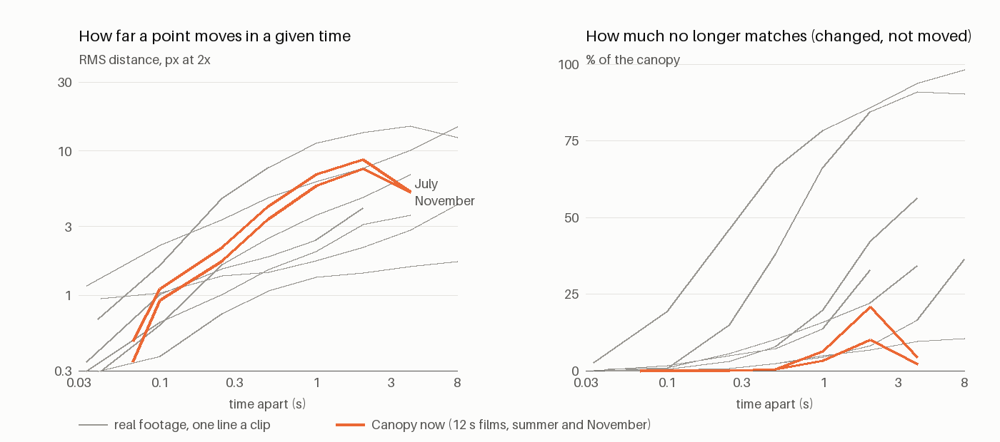
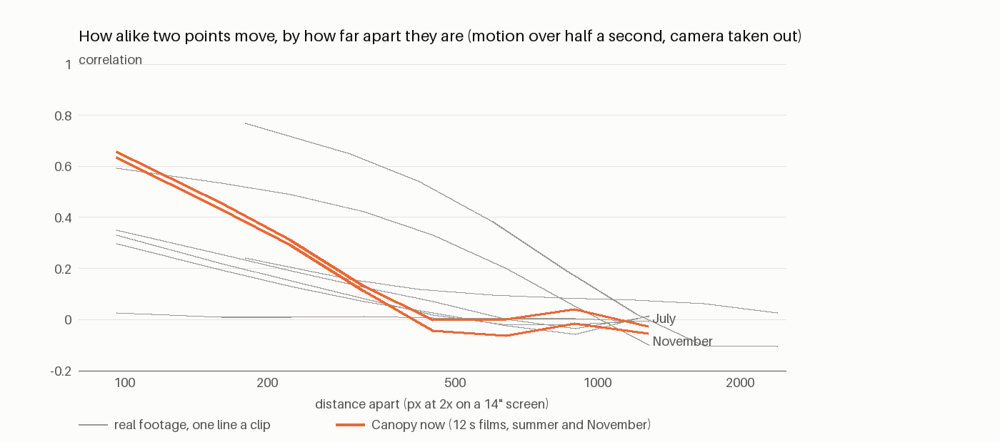
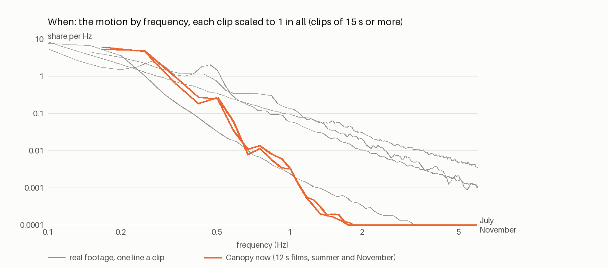

# Canopy: how real canopies move, seen from below

A research agent's report, 2026-11-18, after Dave's word on step (b)'s sway: "it looks super unrealistic, its obvious just the wavy effect being applied to an image". It measures freely licensed footage of trees in wind filmed looking up, block by block, sets it against Canopy as built (commit 60c6fc9, rendered the same way), and proposes motion models from the numbers. Nothing here is built. The model for this report is `docs/jellyfish/research-motion.md`.

**How to read the marks.** As in research-method.md: **checked** means read in the source (with its URL); **[abstract]** or **[search summary]** means only that; **unchecked** means no source was read. **Measured** figures are mine, from the footage or from Canopy's own frames. **By eye** means read from frames, not tracked. All distances are **px at 2x on a 14" screen through Canopy's 90° lens** (1512 px per unit of tan, so 26 px a degree at the middle), and **px/s** likewise; at a canopy 20 m up, 1 px is about 1.3 cm, 100 px about 1.3 m.

## Summary: the signature of real canopy motion, and what gives Canopy away

From 7 steady-camera clips (maples in leaf, a bare limb and its twigs, a tropical crown, autumn crowns, 12–30 s each) and 13 hand-held or moving ones used for the faster measures only, ranked by how much each gives a fake away:

1. **Big wood stays still; what moves is small and on its own.** In a light breeze the median point of a real canopy moves 0.5–5 px/s (95th percentile 4–50) and has drifted 1.3–6 px from where it was a second before; the blocks on trunks and solid limbs move with nothing around them (neighbour correlation 0.08–0.19, which is measurement noise: they barely move). In Canopy every class moves alike (November: twigs, limbs and solid wood all 2.8–3.0 px/s median), and its solid wood moves most coherently of all (neighbour correlation 0.83–0.85). **This is the rubber trunk Dave sees.**
2. **Real foliage changes, not only moves.** Within 1 s, 14–79% of a breezy canopy's texture no longer matches itself anywhere nearby (leaves turn, cross and hide each other), 4–5% in still air; by 4 s, 34–94%. Canopy's picture only ever shifts: 3–6% lost at 1 s, and that only where it moved out of the matcher's reach. A warped photo is recognisable precisely because it stays the same photo.
3. **Small coherent patches.** With the camera's own motion taken out, two points ~100 px apart move alike at a correlation of 0.33 in the median clip (0.03 in still air to 0.77 when whole crowns sway), falling to 0.1 by 250–450 px (3–6 m at 20 m up). Canopy: 0.64–0.66 at 100 px with the same treatment, and 0.77–0.79 as it is drawn, still 0.34–0.41 at 1,280 px: the whole picture swings as four smooth sheets.
4. **Broadband, not a pendulum.** Real displacement falls off as a power law with frequency, with no single period: 69–99% of it below 0.5 Hz, **10–30% between 0.5 and 2 Hz** in the breezy clips, and a tail past 5 Hz; at most 18–39% of it within ±20% of any peak. Canopy: 97–98% below 0.5 Hz, 2–3% in 0.5–2 Hz, nothing above 1 Hz, and 45–55% within ±20% of its 0.17 Hz peak, so a point comes back where it was every few seconds (its drift at 4 s is less than at 2 s; real drift keeps growing to 8 s).
5. **Gaps flicker; Canopy's are swept.** Where crown meets sky, a real pixel stays sky for a median 0.25–0.8 s (0.4 typical) and leaf for 0.17–0.9 s; Canopy's stay open 0.6–1.1 s and closed 0.7–0.8 s, opened and closed by the slow swing, and none can open inside a crown, since the crown is one picture.
6. **Whole crowns do sway, slowly, when the wind is up.** In the strongest steady clip (autumn crowns, ultra-wide) whole crowns moved together at 0.10–0.2 Hz (neighbour correlation 0.77, 0.2 at ~850 px), 11 px in a second. So Canopy's sway isn't wrong in kind for a windy day, it is wrong as the *only* motion, on the wood, in every wind.
7. **Gusts arrive together.** Over the view (about 40 m of canopy) the 1-s mean speed varies by a coefficient of 0.11–0.36 (one calm clip 1.3: still air with puffs) and its 90th over 10th percentile is 1.3–3.1, close to Canopy's 1.7–1.9; in most clips the whole view livens within 0.1 s; in one (maples, Appleton Farms) a gust crossed it right to left at about 930 px/s (12 m/s at 20 m). Gusts are not where Canopy gives itself away.

**Conifers:** no straight-up conifer clip was found; two side views of pines in gales (hand-held) show the masses moving as whole bodies (correlation 0.32 still at 1,300 px) with fast needle-tip motion on top (twig speed 15–18 px/s median, 52–70 at the 95th). Treat conifers as rigid masses with a little edge motion until real footage says otherwise.

## The gap

| Measure | Real (steady clips, light air to breeze) | Canopy now (July, November) | What gives it away |
|---|---|---|---|
| Speed, median / 95th pct (px/s) | 0.5–10 / 4–50 | 2.2–2.9 / 11–18 (camera fit out); 2.9–3.6 / 13–20 as drawn | the amount is plausible; not where it is |
| Solid wood vs twigs | wood near still, its blocks uncorrelated (0.08–0.19); twigs and leaves 1.5–2× faster | equal in November (2.8 / 3.0 / 2.9); wood the most coherent (0.83–0.85) | trunks and limbs bend like rubber |
| Drift after 1 s / 4 s (RMS px) | 1.3–11 / 1.6–15, still growing at 8 s | 7–8 / 6.6–7 (comes back) | regular, pendulum-like |
| Texture no longer matching after 1 s / 4 s | 4–79% / 10–94% | 3–6% / 2–4% | a warped image, never a new arrangement |
| Correlation at ~100 px; distance to 0.1 | 0.03–0.77 (median 0.33); 250–1000 px | 0.64–0.66 (0.77–0.79 as drawn); ~330 px (never, as drawn) | big sheets moving as one |
| Displacement below 0.5 / 0.5–2 / above 2 Hz | 69–99 / 1–31 / 0–5% | 97–98 / 2–3 / 0% | no rustle, no flicker of motion |
| Share within ±20% of the peak frequency | 0.18–0.39 (long clips) | 0.45–0.55 | periodic |
| Gap open / closed (median s) | 0.25–0.8 / 0.17–0.9 | 0.6–1.1 / 0.7–0.8 | gaps swept, not twinkling; none inside crowns |
| Gust variation (1-s CV; p90/p10) | 0.11–0.36 (still air 1.3); 1.3–3.1 | 0.17–0.26; 1.7–1.9 | fine for now |
| Gust front | simultaneous over the view; once ~930 px/s | everywhere at once | fine for now |

The plots are of numbers only (the 7 steady clips and Canopy's two films, both with the camera's fit taken out). The left of the first shows the amounts overlap; the right shows the difference in kind: the real canopy stops matching itself, Canopy never does (its bump at 2 s is displacement past the matcher's 32 px reach, which comes back by 4 s).

## Three motion models, ranked

All three keep Canopy's design: one sprite, one shader reading baked textures, a few uniforms shared by both pictures set on the CPU, nothing per sprite. The current sway's pieces they replace are the four groups' offsets (`u_swayA`, `u_swayB`), the 700 px ramp and blur in `CanopyBake.trees`, and the limbs' travelling sine (`u_limb.xyz`).

### 1. Still wood, rustling twigs and leaves (the cheapest honest fix)
- **What moves:** nothing thick. A point's freedom `m` is 0 on trunks, limbs and the evergreens' masses and rises with its distance out from them along the thin wood and leaves: `m = smoothstep(0, 80 px, distance to thick wood)` (thick as `grow` already finds it: a 4 px block over 85% covered, blurred). Each free point moves by `m · A(t) · n(q, t)`, where `n` is a vector noise of cells about 150 px across (a spray and its twig; real correlation 0.3 at 100 px, 0.1 by 250–450), blended bilinearly as the flutter is, each cell's offset a sum of three sines at hashed frequencies spread over 0.15–1.5 Hz with amplitudes falling as 1/f, so about 80% of the displacement is below 0.5 Hz and 15% in 0.5–2 Hz, as measured; no common period, so nothing comes back on a beat.
- **How much:** RMS drift after 1 s of 1.5 px in light air, 2–4 in a breeze, 6–11 in a strong one (the measured range; `A` from the wind, below). The leaves' light flutter shrinks to a leaf (12–16 px cells rather than 24) at 1–3 Hz, times `m`, standing in for leaves turning (the texture change of item 2, which this model can't make by motion); real leaves flutter at 6–8 Hz (Tadrist 2018), too fast to draw at 15–30 fps, so this is a slower change of light, fading out below 15 fps.
- **Gusts:** `A(t)` from the wind's own gusts (live in step (d)), one envelope for the view, optionally lagging across it at about 900 px/s along the wind's heading.
- **Bake:** a freedom map in place of the sway map (an eighth the size, one channel; a distance transform of the thick wood at a quarter size, a few ms). Every bake with one seed makes the same map.
- **Straight wood and seams:** wood thick enough to read as straight doesn't move; thin twigs are anchored at their limb (`m` = 0 there) and bend outward, as twigs do. No seams: one continuous field.
- **Cost (estimate):** the sway map's one read becomes the freedom map's one read; the noise is about 8 hashes and 12 sines a pixel, twice the flutter's; under 0.1 ms of GPU at 2x on today's 0.38–0.61. CPU: one or two uniforms a frame, as now.
- **Risk:** low to build (it is mostly deletion). The look's risk is research-method's warning: a smooth warp of one picture can still read as heat haze inside the crowns; cells of a spray's size or larger keep each spray nearly rigid. It can't open a gap inside a crown or change which leaf is in front.

### 2. Two layers that move apart, over still wood (recommended)
- **What moves:** Model 1's freedom and noise, but the nearest layer of leaves (`grow`'s layer 0, the 62 px sprays) is kept out of the composite as its own texture and moved by its own noise (another seed, about 1.5× the amplitude: it is nearer and in more wind), over the wood with the middle and far layers moving by the first. Optionally the near layer is split by spray in two textures (alternate sprays by a hashed index), each with its own field, so neighbouring sprays slide independently.
- **What it adds, from the numbers:** near sprays sliding over far leaves and sky open and close gaps inside the crowns and change which leaf is in front, so the texture stops matching itself as a real canopy's does (item 2, the strongest tell after the wood), and the motion has depth.
- **Bake:** stop compositing layer 0 (it is already grown and lit apart, its light already through the layers above); hand it over as a second full-size texture: 3326 × 2268 RGBA, 30 MB (60 MB split in two), during a crossfade twice that. The shade it casts on the leaves below is baked and doesn't follow it, which at a few px won't show.
- **Straight wood and seams:** the wood is in the still picture; every layer is whole and continuous, so nothing is cut or torn. Leaves sliding over a limb is what real leaves do.
- **Cost (estimate):** one more full-size read (two if split) and one more noise field a pixel: +0.1–0.25 ms of GPU at 2x (research-method's measured 4 layers at 3 reads each: 0.36 ms; 33 reads: 0.66), well inside 2 ms; landing a bake uploads 30–60 MB more (today 31–43 ms on the main thread for 30 MB, cause partly unknown).
- **Risk:** medium: memory and the landing's main-thread time; otherwise a contained change to `make()`'s composite and the shader.

### 3. Branches as rigid bodies (for the bare stand, the most physical)
- **What moves:** each limb and twig turns rigidly about where it joins its parent by a small angle `θ(t)` (two levels: twig on limb), straight wood staying straight; tips 2–6 px RMS at 300 px out means about 0.4–1.1° (measured tip drift). Trunks still.
- **Bake:** skeleton of the cleaned stand at a quarter size, split at junctions; per pixel the pivot's offset, an id and the level (RGBA at 832 × 567, 1.9 MB). About 100–300 ms more off the main thread (estimate).
- **Seams:** where two branches cross on the screen a pixel follows the one in front in the still picture, so crossings tear by up to the tips' few pixels; the sub-pixel twig haze can't be skeletonised and falls back to Model 1's field.
- **Cost (estimate):** one more small read and two rotations a pixel, +0.05–0.1 ms of GPU.
- **Risk:** high: a photo's twig haze doesn't skeletonise cleanly, real twigs bend as well as turn, and in leaf the leaves hide it. Worth it only if the bare stand under Model 1 or 2 still reads rubbery.

**Ranking:** 2, then 1, then 3. **Film first:** 1 and 2 from one build, since 2 is 1 plus the near layer: three films side by side (Canopy now, Model 1, Model 2) in July and November, each at light air, a breeze and a strong wind (A at about 1.5, 3 and 8 px RMS drift a second), 12 s each, as `docs/canopy.md` → "Checking it" makes them. Measure each with the same script before showing Dave: the wood's correlation should fall below 0.2, the 1-s lost share rise into the real 15–60% for a breeze (Model 2), and the 0.5–2 Hz share reach 10–20%.

**Battery:** at the measured breeze (95th percentile 13–50 px/s) the fastest tenth of points move 1–3 px a frame at 15 fps, so 15 fps holds in a light breeze and a strong wind needs 20–30; Model 1's light flutter at 1–3 Hz should fade below 15 fps as research-method planned.

## Settings it implies: motion with the real wind

What moves is set by the wind as the Beaufort scale describes it, which is Model 1's freedom map with its threshold of "thick" rising with the wind, plus whole-crown sway only from about Beaufort 5. From the footage alone: median speed 0.5–0.7 px/s in still air, 2–5 in a breeze, 10–18 in gales (hand-held, rough).

| Open-Meteo's 10 m wind (Beaufort) | What moves (Beaufort's words, **checked**) | In Canopy |
|---|---|---|
| under 1.4 m/s (0–1) | nothing much | still air: leaves only, about 0.5 px/s median (measured, two near-calm clips) |
| 1.4–3 m/s (2) | "leaves rustle" | leaves and the finest twigs (`m` on leaves only); amplitude rising from 0 at about 1.4 m/s, where leaf flutter starts, to full by about 2.6 m/s, where it saturates (Tadrist 2018, **checked**) |
| 3.6–5.1 m/s (3) | "Leaves and small twigs in constant motion" | twigs under ~12 px free; median 2–5 px/s, drift 2–4 px in 1 s (the maples) |
| 5.7–8.2 m/s (4) | "small branches moved" | limbs to ~40 px thick free; a branch mode near 1 Hz joins (Tadrist: branch motion "eventually becomes dominant above about 5 m s−1", **checked**) |
| 8.7–10.8 m/s (5) | "Small trees in leaf begin to sway" | whole crowns begin to sway as bodies, 0.15–0.3 Hz |
| 11.3–13.9 m/s (6) | "Large branches in motion" | big limbs free; crowns sway a few px |
| 14.4–17 m/s (7) and over | "Whole trees in motion" | crowns sway as bodies, the measured windy clip's 10 px/s median and 11 px drift in 1 s; more across the wind than along it |

The Beaufort descriptions are for 10-minute mean winds at 10 m (**checked**, https://www.rmets.org/metmatters/beaufort-wind-scale), the same height as Open-Meteo's `wind_speed_10m`, so they map onto it without a canopy-height correction (no published ratio of the canopy-top wind to the 10 m wind was found, **unchecked**).
- **The leaves' amount** grows slowly: the speed of a cherry tree's foliage rose "only by a factor of about 4 when wind velocity is increased from 1 to 8 m s−1" (**checked**, Tadrist et al. 2018 §3), about U^0.67: so Model 1's `A` at 8 m/s is about 4 times its value at 1.4 m/s, not 30.
- **The crowns' amount** grows fast: trees' deflection fitted linearly against the wind speed squared (**checked**, Jackson et al. 2021 §2.5), so whole-crown sway should be near nothing below Beaufort 5 and grow as U² above it, its frequency the tree's own (0.15–0.3 Hz in leaf, 19% higher bare, research-method.md) whatever the wind.
- **Direction:** pines swayed "mainly perpendicularly to the direction of mean windspeed" (**[abstract]**, Peltola et al. 1993), and the sway at the tree's own frequency "was almost decoupled from near-surface airflow" (**[abstract]**, Schindler et al. 2013): the crowns' sway needn't follow the wind's heading; the leaves' rustle and a gust's arrival should.
- **Gusts** from `wind_gusts_10m`: the envelope's peaks at the gust speed, lulls at the mean; a gust convects at about 1.75 times the wind at canopy height (**[abstract]**, Christen et al. 2008, measured in a forest's trunk space), which with the one measured crossing (about 930 px/s, 12 m/s at 20 m) says a gust crosses the screen in 3–4 s or arrives everywhere at once.

## 1. The footage

Downloaded only to measure, into a scratch folder, and deleted after. No frame of any of it is in the repo. Commons licences were read from each file page through the API on 2026-11-18; Mixkit's clips are under the Mixkit Stock Video Free License (https://mixkit.co/license/#videoFree), 720p previews. No lens is stated for any clip: the field of view is assumed (65° across for phone-like Commons clips, 100° for the obviously ultra-wide Mixkit shots looking straight up, 75° otherwise), which scales every px figure from that clip by its `tan`; a wrong guess of ±10° moves them by ±20–30%. Frequencies, correlations and shares don't depend on it.

| Clip | Licence | What it shows | fps | Lens (assumed) | Camera | Used for |
|---|---|---|---|---|---|---|
| [Wind in tree AppletonFarms Massachusetts 2024-09](https://commons.wikimedia.org/wiki/File:Wind_in_tree_AppletonFarms_Massachusetts_2024-09.webm) (Oakley413) | CC BY-SA 4.0 | maple crowns turning, straight up, a breeze, 42 s (30 used) | 29.67 | 65° | steady (5 px/s) | everything |
| [Wind in tree … 2024-10](https://commons.wikimedia.org/wiki/File:Wind_in_tree_AppletonFarms_Massachusetts_2024-10.webm), [Wind in trees … 2024-10](https://commons.wikimedia.org/wiki/File:Wind_in_trees_AppletonFarms_Massachusetts_2024-10.webm) (Oakley413) | CC BY-SA 4.0 | a big maple's trunk and limbs in leaf, looking up, 5.4 s and 7.2 s | 29.67 | 65° | steady (5 px/s) | everything |
| [Thomas Bresson - arbres](https://commons.wikimedia.org/wiki/File:Thomas_Bresson_-_arbres.webm) (Thomas Bresson, 2020) | CC BY 4.0 | a thick bare limb and budding twigs against a blue sky and the Sun, still air with puffs, 74 s (30 used) | 23.976 | 65° | steady (1.3 px/s) | everything |
| [Looking Up at Kebun Biologi's Trees (1), (2), (3)](https://commons.wikimedia.org/wiki/File:Looking_Up_at_Kebun_Biologi%27s_Trees_(2).webm) (Joaquim Baeta, 2022) | CC BY 4.0 | tropical broadleaf woodland in leaf, looking up, 10.3, 7.7, 13.7 s | 23.976 | 65° | (2) steady (9 px/s); (1), (3) hand-held | (2) everything; (1), (3) speeds, spectra, correlation |
| [A tree branch bends and swings in the wind during](https://commons.wikimedia.org/wiki/File:A_tree_branch_bends_and_swings_in_the_wind_during.webm) (Ser Amantio di Nicolao, 2018) | CC BY-SA 4.0 | bare broadleaf twigs against cloud, looking up, the March 2018 nor'easter, 16.6 s | 30 | 65° | hand-held (64 px/s) | speeds, spectra, correlation |
| [Trees blow in the wind during the 2018 nor easter](https://commons.wikimedia.org/wiki/File:Trees_blow_in_the_wind_during_the_2018_nor_easter.webm) (same) | CC BY-SA 4.0 | pines from the side in a gale, 31.5 s | 30 | 65° | hand-held | conifers, by speed only |
| [Spring winds in Tuntorp](https://commons.wikimedia.org/wiki/File:Spring_winds_in_Tuntorp.3gp.ogv) (W.carter, 2021) | CC BY-SA 4.0 | pines and bare broadleaves from the side, "about 20 m/s" by its description, 34.9 s, 640 × 480 | 29.97 | 60° | hand-held, shaky | conifers in a gale, speed only |
| Mixkit [17670](https://mixkit.co/free-stock-video/bottom-view-of-autumn-trees-moved-by-the-wind-17670/) "Bottom view of autumn trees moved by the wind", [45270](https://mixkit.co/free-stock-video/looking-up-at-the-canopy-of-autumn-trees-45270/) "Looking up at the canopy of Autumn trees" | Mixkit free | autumn crowns straight up, 20 s each | 25 | 100° | steady (7 and 0.2 px/s) | everything |
| Mixkit [7913](https://mixkit.co/free-stock-video/large-tree-canopy-7913/), [45289](https://mixkit.co/free-stock-video/looking-up-into-a-canopy-of-trees-45289/), [45621](https://mixkit.co/free-stock-video/green-forest-floor-looking-up-at-a-canopy-45621/), [50848](https://mixkit.co/free-stock-video/the-camera-captures-the-tree-canopy-from-the-ground-position-50848/), [50863](https://mixkit.co/free-stock-video/big-trees-with-tall-branches-gently-moving-with-the-wind-50863/), [50865](https://mixkit.co/free-stock-video/trees-branches-and-leaves-cover-the-sky-50865/), [52419](https://mixkit.co/free-stock-video/the-tree-branches-gently-moving-with-the-wind-over-a-52419/), [3969](https://mixkit.co/free-stock-video/sunlight-through-the-branches-being-moved-by-the-wind-3969/) | Mixkit free | broadleaf crowns looking up or across, in leaf, in fog, hanging twigs on blue, silhouettes with the Sun, 8–31 s | 23.976–25 | 75–100° | turning or gliding (1.5–2.9°/s, 11–66 px/s) | speeds, spectra and correlation (camera fit out), weakly |

Missing: a conifer stand filmed straight up (none found on Commons or Mixkit; Pexels and Pixabay refuse scripted access), and any clip with a measured wind speed. NPS and USFS footage weren't searched for lack of time. Stock clips may be slowed down; none was tested for it, though their frequencies (0.1–0.5 Hz crowns, power out to 5 Hz) are in the range of the phone clips.

## 2. Method

Frames at 960 px wide (gray) and 480 (colour, for masks), at the clip's own rate, the first 30 s at most; Canopy's at 1512 (half its 2x render) and 756, 15 fps. Scripts in numpy (no OpenCV available): **phase correlation** of 32 px blocks every 16 px (Hann-windowed, sub-pixel by a parabola, a match kept if its normalised peak is over 0.25 and the block has texture), so each block is 64 px at 2x (a little more than one of Canopy's 62 px sprays).
- **The camera** is taken out frame pair by frame pair by a similarity (shift, zoom, turn) fitted by weighted least squares to the blocks, dropping outliers, either to the solid wood when 20 or more blocks of it are in view (it moves least) or to all; Canopy is measured both ways ("as drawn" and "camera fit out") so it can be compared like for like, since the fit also takes out motion common to the whole view.
- **Velocity** from frames about 0.08 s apart (15 fps for Canopy), then speeds, spectra (each block's displacement spectrum from its velocity's, averaged by class), coherence (velocity smoothed over 0.5 s to keep the sway band and drop the matcher's noise; correlation over time between every two blocks valid 85% of the time, binned by distance, overlapping blocks left out), gusts (the mean speed, smoothed over 1 s; the lag of each quarter of the view's envelope behind the first's, across and down).
- **Drift after a lag** by matching frame t directly to frame t + lag (no drift from adding up), lags 1 frame to 8 s, every half second: the RMS and 95th percentile distance of the blocks that still match, and the share of textured blocks that **no longer match** (changed, or moved more than the 32 px at 2x a block can see). Matched distances understate where many are lost.
- **Classes**, per block each frame: sky (under 8% covered; sky is bright and blue or neutral), foliage (over half the cover saturated green, yellow or red; edge under 75% covered, mass over), else wood by thickness (twice the distance to the sky at the 95th percentile, at 2x): twigs under 12 px, limbs 12–40, trunks and solid masses over 40. A dark shaded mass of leaves or a conifer mass counts as "solid", and a sunlit grey trunk can count as foliage: classes are indicative.
- **Gaps:** for pixels sky between 10% and 90% of the time, how long each stays sky and covered, and how often it flips.
- **Canopy:** `SNAPSHOT_MOVIE=12` films of seed 3 at 42°N 88°W, 15 July 3:30 pm and 17 November 1 pm (render test, 15 fps frames, 4 s in).

## 3. Measured, clip by clip (steady cameras)

| Clip | Speed median / 95th (px/s) | Drift 1 s / 4 s (RMS px) | Lost 0.25 / 1 / 4 s | Corr. ~100 px | <0.5 / 0.5–2 / >2 Hz | Gap open / closed (s) |
|---|---|---|---|---|---|---|
| Maples 2024-09, 30 s (breeze) | 5.2 / 48 | 6.1 / 10.2 (14.8 at 8 s) | 46 / 79 / 94% | 0.33 | 0.82 / 0.16 / 0.01 | 0.34 / 0.40 |
| Maple trunk 2024-10 a, 5 s | 1.9 / 19 | 2.4 / – | 5 / 14 / –% | 0.30 | 0.69 / 0.26 / 0.05 | 0.54 / 0.27 |
| Maple limbs 2024-10 b, 7 s | 1.9 / 13 | 2.0 / 3.6 | 3 / 20 / 56% | 0.35 | 0.88 / 0.10 / 0.02 | 0.40 / 0.34 |
| Bare limb and twigs (Bresson), 30 s, still air | 0.7 / 5.3 | 1.7 / 2.8 (4.3 at 8 s) | 1 / 4 / 17% | 0.03 | 0.81 / 0.15 / 0.04 | 0.25 / 0.17 |
| Tropical crown (Kebun 2), 8 s | 2.7 / 11 | 3.6 / 6.9 | 6 / 16 / 34% | 0.60 | 0.86 / 0.12 / 0.02 | 0.33 / 0.33 |
| Autumn crowns (Mixkit 17670), 20 s, wind | 10.4 / 42 | 11.3 / 15.0 | 15 / 66 / 91% | 0.77 | 0.99 / 0.01 / 0.00 | 0.48 / 0.88 |
| Autumn crowns (Mixkit 45270), 20 s, near calm | 0.5 / 3.6 | 1.3 / 1.6 | 1 / 5 / 10% | 0.24 | 0.79 / 0.19 / 0.02 | 0.80 / 0.80 |
| **Canopy, July** (fit out / as drawn) | 2.8 / 18; 3.6 / 20 | 6.9 / 5.2; 8.3 / 7.0 | 0 / 6 / 4% | 0.66; 0.77 | 0.97 / 0.03 / 0.00 | 0.60 / 0.80 |
| **Canopy, November** | 2.2 / 11; 2.9 / 13 | 5.7 / 5.2; 7.2 / 6.6 | 0 / 3 / 2% | 0.64; 0.79 | 0.97 / 0.03 / 0.00 | 1.13 / 0.73 |

- **By class** (median speed px/s, twigs / limbs / solid / foliage edge / foliage mass): maple limbs 2.2 / 1.9 / 1.5 / 2.3 / 1.8; bare limb 1.1 / 0.8 / 0.6 / 1.6 / 1.3; maples (30 s) 4.8 / 5.0 / 7.5 / 5.7 / 5.1 (its "solid" is shaded leaf mass); Canopy July as drawn 5.8 / 5.8 / 3.2 / 5.0 / 3.4, November 2.8 / 3.0 / 2.9. Thin things move 1.5–2× the thick in the real clips; the thick blocks' motion is mostly the matcher's noise (they correlate with their neighbours at 0.08–0.19 where foliage does at 0.3–0.8). **By eye** from where each clip changes over a second: in the bare clip only the twigs, buds and the limb's outline change, the limb itself not at all; in the maples it is the leaves' edges, everywhere, each leaf on its own; in Canopy's November film every twig in a region smears the same way at once, like combed hair.
- **Hand-held clips** (speeds and spectra only): bare twigs in the nor'easter 12.5 / 44 px/s (limbs 9.9 / 32), 0.82 / 0.18 / 0.00 of displacement below 0.5 / 0.5–2 / above 2 Hz, correlation 0.48 at 100 px and 0.03 by 320; pines in that gale 15 / 52, still 0.32 at 1,300 px (whole trees); Tuntorp's 20 m/s storm 18 / 70 (rough); hanging twigs on blue (Mixkit 52419) swing at a median 0.62 Hz with 31% of their displacement in 0.5–2 Hz, the most of any clip.
- **When:** displacement spectra fall as roughly 1/f² to 1/f³ from 0.2 Hz to past 5 Hz in the breezy clips; where a peak shows it is 0.13–0.2 Hz (whole crowns: Mixkit 17670, Kebun 1 and 2, at 0.15–0.19 Hz). Clips of 5–8 s can't resolve below about 0.15 Hz. No ring-down after a gust was seen in 30 s windows (unchecked: needs longer clips with a known gust).
- **Gusts:** 1-s CV 0.12–0.36 in breezes; the still-air clip 1.31 (puffs); one lull of 3 s (Mixkit 17670); the maples' gust crossing at about 930 px/s from the right (lags 0.2, 1.2 and 1.55 s across 480, 960 and 1,440 px; correlations 0.91, 0.66, 0.50); Kebun 3 about 830 px/s (hand-held, correlation 0.4); elsewhere no lag above 0.1 s at correlations of 0.8–0.99.
- **Layers:** not separable by these measures (no depth); by eye, nearer and lower foliage in the maples moves more and blurs, the far crowns barely shift. Model 2's 1.5× is a guess from that.

## 4. Canopy now, as measured
- **What moves:** everything, by four smooth translations at 0.17–0.33 Hz (displacement peak at 0.17 Hz, the measurement's bin), strength 0.35–1 over a minute; over 12 s the median point moves 2.9–3.6 px/s, 95th 13–20, the same for twigs, limbs and solid wood in November. The limbs' own 2 px at 0.47–0.53 Hz is the only motion above 0.4 Hz (2–3% of the displacement).
- **Coherent:** 0.77–0.79 at 100 px, 0.34–0.41 at 1,280 px as drawn; the whole picture is one smooth field.
- **Periodic:** drift after 4 s (6.6–7.0 px) is less than after 2 s (9.7–10.6): points swing back.
- **Never changes:** 3–6% of the texture fails to match after 1 s and 2–4% after 4 s, where real breezy canopies lose 14–79% and 34–94%. Gaps open for 0.6–1.1 s, as the whole sheet slides.

## 5. Literature

- **Foliage motion, leaf to branch** (Tadrist et al. 2018, a 3 m cherry tree in a wind tunnel, **checked**, https://pmc.ncbi.nlm.nih.gov/articles/PMC6000177): a branch mode of "low frequency content (about 1 Hz)" and a leaf mode "about 8 Hz" (Fig. 3); leaf torsion 6 ± 1 Hz, damping 0.034 (Table 1); flutter starts at "Uc = 1.35 m s−1" and saturates "at about 2.6 m s−1" (§4); branch motion is "negligible at low wind" and "eventually becomes dominant above about 5 m s−1" (§3); foliage velocity "increases only by a factor of about 4" from 1 to 8 m/s (§3); the model's branch buffeting grows "as U^11/6" (§4). This is the footage's picture: in a breeze leaves and twigs move on their own and the wood is still; the 10–30% of displacement measured in 0.5–2 Hz is the branch mode's band; the leaves' 6–8 Hz is too fast to film at these rates or draw at 15–30 fps, so a shimmer of light, not of place.
- **Whole-tree deflection** goes with the wind speed squared (Jackson et al. 2021, 243 trees, a linear fit of deflection on U², **checked**, https://bg.copernicus.org/articles/18/4059/2021/bg-18-4059-2021.html); "damping or amplification mechanisms do not change dramatically at high wind speeds" (Abstract, **checked**). Damping 8.6 ± 2.2% of critical in leaf and 3.9 ± 1.3% bare; a sycamore at 0.26 Hz (Jackson et al. 2019, **checked**, https://pmc.ncbi.nlm.nih.gov/articles/PMC6597771).
- **Branches and trunk:** "All large branches had nearly the same frequency as the tree" (Douglas fir, Spatz et al. 2007, **[abstract]**). Scots pines 9.5 and 13.5 m tall bent under 2 and 5 cm at crown centre in 4–8 m/s (Peltola 1993 as cited, **unchecked**); they swayed "mainly perpendicularly to the direction of mean windspeed" (**[abstract]**).
- **Reconfiguration:** drag "not always quadratic", a slope of U^−2/3 against U² "compatible with the data" (Tadrist 2018 §4, **checked**); highly bent structures' drag "as U^{4/3}", "consistent with experimental data on many plant species" (Lopez et al. 2013, **checked**, https://ar5iv.arxiv.org/html/1305.4995).
- **Canopy turbulence:** dominant eddies spaced 8.1 shear lengths apart along the wind (Raupach, Finnigan & Brunet 1996, **[abstract]**), convecting at 1.75 times the wind at canopy height (Christen et al. 2008, **[abstract]**, in the trunk space). A gust's duration at canopy top: not found.
- **Seen from above by video:** canopy motion of oak and camphor trees, measured by image correlation in 1–8 m/s, scaled "nearly linearly" with the wind in mid range, with a plateau outside it (Goldshmid & Dabiri 2022, **checked**, https://ar5iv.labs.arxiv.org/html/2209.01681).
- **Light through moving leaves:** 79% of sunflecks under soybean lasted 1.6 s or less (Pearcy 1990, **unchecked**); a simulated rice canopy's 6° of sway moved its top 7.6 cm and raised the light on a leaf section by up to 350% (Burgess et al. 2016, **checked**, https://www.frontiersin.org/articles/10.3389/fpls.2016.01392/full). The measured gaps here, open a median 0.25–0.8 s, agree with flecks of a second or less.
- **Log profile:** displacement height d = 2/3 h and roughness z0m = 0.123 h for a crop (FAO-56 Box 4, **checked**, https://www.fao.org/4/x0490e/x0490e06.htm); no ratio of the canopy-top wind to the 10 m wind for a forest was found.

## 6. Not verified
- Every px figure from footage rests on an assumed field of view (no lens is stated for any clip) and on trees about as far up as Canopy's stand; a tree half as high moves twice as many px for the same sway.
- Wind speeds: none of the clips states one but Tuntorp ("about 20 m/s"); "light air", "breeze" and "wind" here are by eye.
- Whether any stock clip is slowed down.
- Conifers seen straight up: no footage; side views only, hand-held.
- Classes are by colour and thickness; shaded leaf masses count as solid wood and some sunlit bark as foliage.
- Drift after a lag counts only blocks that still match, so where many are lost (the breezy maples) it understates.
- The models' costs are estimates from research-method.md's measured shaders, not measured.

## Sources

**Footage:** as listed in §1; Commons clips under CC BY 4.0 or CC BY-SA 4.0 (attribution as listed), Mixkit's under its free licence. None of it is in the repo; the plots here are of numbers measured from it.

**Working files:** the scripts (`flow.py`, the measurement as in §2; `extract.py`; `plot.py`; `table.py`) were left in the session's scratch folder (`/private/tmp/claude-501/…/scratchpad/motion/`), which a reboot clears; the footage, frames, Canopy's films and per-clip results were deleted. Not in the repo; §2 is enough to redo it with numpy and ffmpeg.

**Papers and pages** (read 2026-11-18 by a research agent, marks as in §5):
- Tadrist L et al. 2018, "Foliage motion under wind, from leaf flutter to branch buffeting", *J R Soc Interface* 15:20180010. https://pmc.ncbi.nlm.nih.gov/articles/PMC6000177
- Jackson T et al. 2021, *Biogeosciences* 18:4059. https://bg.copernicus.org/articles/18/4059/2021/bg-18-4059-2021.html
- Jackson T et al. 2019, "An architectural understanding of natural sway frequencies in trees", *J R Soc Interface*. https://pmc.ncbi.nlm.nih.gov/articles/PMC6597771
- Spatz H-C, Brüchert F, Pfisterer J 2007, *Am J Bot* 94:1603 (abstract, Europe PMC 21636359).
- Peltola H et al. 1993, *Silva Fennica* (abstract); Schindler D et al. 2013, *Int J Biometeorol* (abstract, Europe PMC 23196785).
- Lopez D, Michelin S, de Langre E 2013. https://ar5iv.arxiv.org/html/1305.4995
- Raupach MR, Finnigan JJ, Brunet Y 1996, *Boundary-Layer Meteorol* 78:351 (abstract); Christen A et al. 2008, AMS 18th BLT (abstract). https://ams.confex.com/ams/18BLT/webprogram/Paper139937.html
- Goldshmid RH, Dabiri JO 2022. https://ar5iv.labs.arxiv.org/html/2209.01681
- Burgess AJ et al. 2016, "The 4-Dimensional Plant", *Front Plant Sci*. https://www.frontiersin.org/articles/10.3389/fpls.2016.01392/full
- FAO Irrigation and Drainage Paper 56, Box 4. https://www.fao.org/4/x0490e/x0490e06.htm
- The Beaufort scale: Royal Meteorological Society, https://www.rmets.org/metmatters/beaufort-wind-scale; NWS Miami, https://www.weather.gov/mfl/beaufort
- Not read: Moore & Maguire 2004 and 2005 (blocked); James, Haritos & Ades 2006 (no figures found); Tadrist et al. 2015 on leaf flutter (abstract only, no numbers); Kaiser et al. 2018 (blocked).
