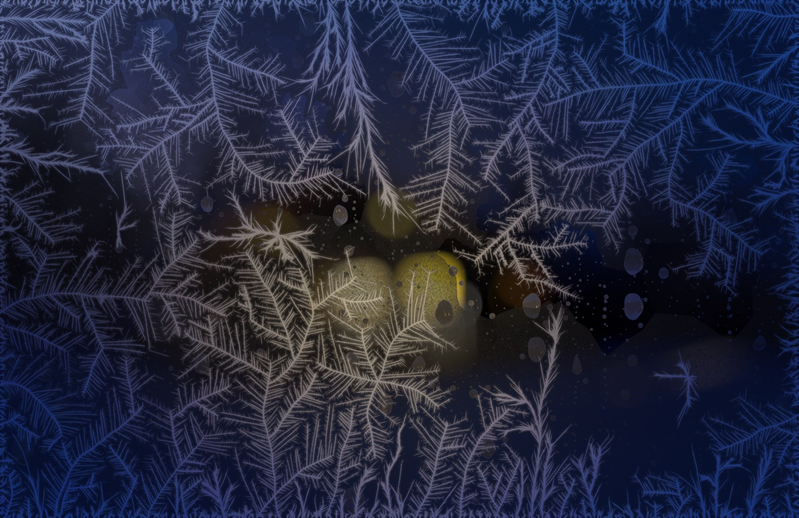

# Rain on Glass

Looking through a rainy window, with the camera focused on the glass. With Follow the weather on, the glass shows what the weather where you are is doing to a real window: rain when it rains, drops drying when it stops, fog on humid mornings, snow, and fern frost growing across the pane below freezing. Behind the glass is a real place, heavily defocused, or a city of bokeh lights in a palette. Beads of water sit on the pane, and drops creep down in lurches, now and then run, and leave trails of pearls behind them. Each drop is a strong lens showing a sharp, upside-down view of the scene. Night in Dark Mode, an overcast day in Light Mode; following the weather, night or day by the real Sun.

- **Files:** `Sources/Atrium/RainOnGlass.swift` (the scene and its shaders) `RainWeather.swift` (following the weather: its settings, `GlassWeather` and `GlassUniforms`), `RainFrost.swift` (the frost's bake) and `RainCity.swift` (the bokeh city's), using the `shaderCommon` helpers from Shaders.swift (`hash42`, `noise`, `grade`…). Photos are `Resources/rain-<look>-near.jpg`, `-far.jpg` and `-haze.jpg`, credited in `Resources/rain-credits.tsv` and Settings → About.
- **Entry:** `@MainActor func rainOnGlass(size:)` picks the backdrop (`rainBackdrop(picked:)`: Hamburg until one is picked, any photo on Random, the pool being `rainRotation`), and `rainScene(size:backdrop:clock:)` builds the one `shaderScene`, `rainGlassScene`, over a photo's three textures or a baked city's (`RainCity`), and runs the timer that fades to the next backdrop. Registry entry: icon `cloud.rain.fill`, tint `.gray`, `knobs: rainKnobs`, and `rainBackdrops`, a `PaletteChoice` titled "Backdrop" that lists the photos (with `photos:` thumbnails) and then the bokeh palettes.
- **Kind:** a single full-screen SKShader, the same over every backdrop (a city's adds its traffic), animated by `u_clock`, which runs at the Drip speed.

## Backdrops
Ten photo backdrops, each with a night look for Dark Mode and a day look for Light Mode where a good one exists:

| Backdrop | Night | Day |
|---|---|---|
| Hamburg | Rathausmarkt in the rain (Poly Haven `rathaus`) | a warehouse canal (`hamburg_canal`) |
| Riomaggiore | a wet square with lamps (`vignaioli_night`) | the harbour between painted houses (`vignaioli`) |
| Japan | a Tokyo yokochō with lanterns (Commons, CC BY 3.0) | Hanamikoji in Gion, Kyoto (Commons, CC BY 3.0) |
| Forest | lit windows through bare woods at dusk (`pond_bridge_night`) | misty pines (`misty_pines`) |
| Countryside | lamps across a foggy field (`kloppenheim_04`) | a farm track into fog (`misty_farm_road`) |
| Winter | Blaubeuren's square with string lights (`blaubeuren_church_square`) | a snowy orchard (`snowy_park_01`) |
| Lake | Lake McDonald at dusk (NPS) | Lake McDonald under cloud (NPS) |
| Tropics | a palm-lined street at night (Commons, CC BY 2.0) | Cheow Lan Lake in low cloud (Commons, CC BY 4.0) |
| Cabin | a cabin's two lit windows in snow at blue hour (USFWS) | the same |
| Shanghai | the Bund's neon skyline (`shanghai_bund`) | the same |

The Poly Haven files are CC0 HDRIs; the rest are public domain or CC BY, with authors in `rain-credits.tsv`. The shortlist behind these (12 biomes, about 85 HDRIs and 25 photos judged blurred, not sharp) is in the session notes (`notes/rain-backdrops.md`). What mattered:
- **True HDR wins.** In an HDRI a lamp keeps its energy, so the blur spreads it into a bright disc. A photo tops out at white, so its lamps blur into dim grey smudges unless the bake lifts its clipped highlights.
- **Night beats day.** Many point lights over wet ground look best by far. A day view needs one big shape (a street, a canal, a lake, a ridge) or it turns into grey mush.
- **Aim away from walls.** A camera close to a wall blurs into a flat smear.

The seven bokeh palettes are the original look, a city of out-of-focus lights. Each is its own city, baked as it's first shown into the same three textures a photo has (see The bokeh city):

| Palette | Lights |
|---|---|
| City | sodium orange, warm white, red tail lights, cool LED blue, rare green (the original look) |
| Neon | magenta, cyan, violet, electric blue, rare amber |
| Blue Hour | LED white, steel blue, warm windows, teal, rare red |
| Sunset | gold, rose, amber, lilac, rare cream |
| Harbor | aqua, warm white, green and red channel markers, sodium |
| Holiday | warm fairy lights, red, green, gold, rare blue |
| Graphite | whites and silvers only |

Random starts on any of the ten photos and, unless switched off, fades to another photo every 10 minutes (see Settings). Before any pick Settings shows Random, and it behaves as Random does except that it opens on Hamburg, the look on the menu's tile, in its loop and on the site. The bokeh palettes are picks only, left out of the rotation (`rainRotation`).

## The bake
Each look is baked offline into three textures at a MacBook's 1512:982 aspect; the shader covers other screens by cropping. The script (`rain/bake.py` in the session scratchpad, about 80 lines of numpy) does:
1. **View.** From an HDRI: a rectilinear view of the equirect (yaw 0 is its middle, + turns right) at the yaw, pitch and horizontal FOV below. From a photo: a full-width crop at the given centre height, decoded to linear light, with near-white pixels lifted up to 7× (a squared ramp above 0.75) so their lamps bloom like real ones.
2. **near** (1024 wide): the view, area-downsampled and tonemapped. It's only ever seen small and upside down inside drops, so 4k HDRIs are plenty.
3. **far** (768 wide): a disc blur of the *linear* light, radius 3% of the width (bokeh discs about 9% of the screen height across, as a 30-40 cm pane at f/1.8 gives), with a soft edge and a slightly brighter rim, then tonemapped.
4. **haze** (128 wide): a Gaussian of sigma 0.2 screen heights, the glow a misted pane scatters light into.

Tonemap: `1 − exp(−x·exposure)`, then sRGB, JPEG at quality 90. Each look is about 150 KB; all 18 are 2.9 MB.

| Look | Source | yaw | pitch | hfov | exposure |
|---|---|---|---|---|---|
| hamburg-night | rathaus | −60 | 3 | 80 | 0.4 |
| hamburg-day | hamburg_canal | 4 | −5 | 70 | 1.0 |
| riomaggiore-night | vignaioli_night | 8 | 3 | 75 | 0.3 |
| riomaggiore-day | vignaioli | −12 | −10 | 70 | 1.2 |
| forest-night | pond_bridge_night | 150 | 3 | 75 | 0.6 |
| forest-day | misty_pines | 0 | 3 | 75 | 1.1 |
| countryside-night | kloppenheim_04 | 10 | 0 | 75 | 0.6 |
| countryside-day | misty_farm_road | −72 | 0 | 75 | 1.1 |
| winter-night | blaubeuren_church_square | −60 | 3 | 80 | 0.4 |
| winter-day | snowy_park_01 | 0 | 3 | 75 | 0.8 |
| shanghai-night | shanghai_bund | 35 | 3 | 70 | 0.5 |

Photos (crop centre height as a fraction of the photo, exposure): japan-night Yokocho.jpg 0.55, 0.7; japan-day Gion6550.JPG 0.55, 1.0; lake-night Lake McDonald and the Sprague Fire at Dusk 0.5, 1.0; lake-day Lake McDonald 0.5, 1.0; tropics-night Tropical City Streets at Night 0.5, 0.4; tropics-day Cheow Lan Lake 0.5, 1.0; cabin-night Cozy cabin at night 0.55, 1.0. The 1920-3840 px Commons downloads are plenty.

## The bokeh city
`RainCity` (2026-11-14). Until then the city was arithmetic in a shader of its own: five grid layers of discs, one light per cell, worked out up to three times a pixel. The review of every wallpaper found it the weakest look ("flat-filled discs sprinkled evenly, one per grid cell, like polka dots, where real bokeh comes in rows and clusters with a few very bright and most dim"; drops over it "dark pebbles with single-pixel coloured specks inside"), and the only one over budget in weather. Now a palette's city is a list of lights, baked once into `far`, `near` and `haze` and drawn by the photos' shader, so it has the photos' optics and the photos' cost.

- **The view:** from a window 55 m up, looking out over a city to a horizon 0.66 of the way up the screen, through the photos' 52° lens. A light at (x across, y above the street, z away) lands at `vanish + focal·x/z`, `horizon + focal·(y − 55)/z`.
- **The lights** (`RainCity.lights(palette:)`, about 500, seeded by the palette so each is its own place):
  - **avenues** every 110-150 m, receding to one vanishing point: a lamp on each kerb by turns, 32 m apart, in the palette's first tint. One is the main one: closer lamps, twice as bright, in the second tint.
  - **cross streets** at 100 and 150 m and then every 90-140 m to 640 m, closing up towards the horizon: a lamp every 22-38 m.
  - **buildings:** 18-24 faces of windows, 4-8 across, 15-40% lit, most in the building's own tint. A third are towers, 16-40 floors, 300-640 m off, floodlit, standing over the horizon with a beacon on top.
  - 14 **signs and signals** at street level in the rare tints, and 50 **far lights** along the horizon with a power-law spread.
  - Each is as bright as the square of its distance leaves it, and dimmer again through the rain (e-fold in 450 m): so the median light's disc is under a tenth of a foreground lamp's, and the top fiftieth are over ten times the median (a test holds it to that). Past 640 m the lamps are a glow along the horizon.
- **The bake** (`RainCity.textures(palette:night:)`, on the main thread as the scene is built: under 90 ms, all fourteen taking 1.2 s in a release build with the test's read-backs, and about 1.5 s each in a debug build): at the photos' 1512:982, and shared by every copy of the scene while one shows it (`sharedTexture`), 1.7 MB.
  - `far` (768 wide): every light a disc of the one size, the photos' 3% of the width, soft at the edge and a little brighter round the rim, summed in linear light and tonemapped `1 − exp(−x)` like the photos, so where lamps crowd or one is bright they bloom to white. A palette's tints are display colours, so they're decoded to linear first; added as they were, sodium came out beige.
  - `near` (256 wide): the lights in focus, each a texel holding its disc's whole energy, with a Gaussian glow (0.035 screen heights) of what it lights round it. It's what gives a drop a body: a band of light with points in it, where the old city's drops were dark with specks. It's small on purpose: a drop shows the whole view in 30-90 pixels, and a bigger texture only aliases.
  - `haze` (128 wide): the same energy spread by a Gaussian of 0.2 screen heights.
  - By day the lights don't add: they tint the palette's overcast sky, `sky × exp(−1.3 × (strength − 0.8 × tint))` as the old city did, with each light's strength squeezed to 0.6 at most and the sum squeezed again, so a crowd of them tints no more than one bright one.
- **Traffic** is the only part still drawn live (`headlights` in the shader, compiled in for a city alone with `#define TRAFFIC`): two lanes crawling opposite ways along the cross street 150 m off, a disc like the baked ones every 0.2 of the screen in 55% of cells, only for pixels within 0.08 of that street. It isn't seen through the drops.

## The water
One model over every backdrop, in `p = v_tex_coord * vec2(aspect, 1)` (1 = the screen height). Its numbers come from measured footage of rain on a window (Frank Vincentz's Radevormwald clips, CC BY-SA, measured only) and droplet physics; see Research below.

1. **Sliders.** One per column 0.06 wide, in 70% of columns, radius 0.009-0.017. `travel(t)` is how far a column's slider has gone, stateless:
   - it creeps in bursts: every 8-25 s it lurches 4-9 times over 2-6 s, 5-12% of the screen in all, each lurch a fast start and a slow stop, then sits still
   - every 12-40 s it swallows a bead and runs 15-40% of the screen at about 1 screen height a second, starting at once and slowing to a stop
   - its height wraps from below the screen to above it (`1.12 − mod(travel, 1.4)`), so a new one slides in from the top
   - every slider in a column follows the same wavy track (`track()`: ±0.1 of the column's width either side of its middle, plus noise of ±0.01), as real drops reuse old wet tracks. Kept that close to the middle, a trail and its pearls never cross into the next column; only a big slider's body can, by up to 0.004, and pixels that close to a column's edge also draw the next column's slider (`sliderBody`).
   - it's a teardrop with a round front and a tail stretched 1.25× at rest to 2.75× at speed, pointing more as it speeds up
2. **When did it pass?** `sinceSlider(y)` finds when the column's slider was last at height y by searching its travel back in time (0.6, 1.8, 5.4 … 146 s, interpolated). That gives each point of a track an age:
   - **trail:** the track, 0.8 of the slider's width, stays clear of mist for 5 s, then mists over for 25 s
   - **pearls:** about one per slider radius down the track, a fifth of its width, fixed to the glass, for 2 minutes
   - **sweeping:** a bead is gone if its own column's slider has passed it since it landed, judged at the bead's middle so the whole bead goes at once
   - a faint wet line runs down every track
3. **Beads.** Two grid layers: cells of 0.04 (radius 0.0025-0.007, 60% full) and 0.09 (radius 0.008-0.022, 45%), sizes skewed small (`u²`). Each lands fully formed at a random moment and lasts 40-160 s unless swept. Big ones are up to 1.4× taller than wide, and lumpy (3 and 5 lobes of ±4.5% and ±2.5%) where their edge snags on dirt.
4. **Mist.** A layer of specks (cell 0.016, radius 0.001-0.002) that land and dry at random, faded out along fresh trails.

The water returns `drop` (position inside the drop on a unit disc, coverage, radius) and `wiped` (how clear of mist the glass is).

## Optics
- **The lens.** A drop is a plano-convex water lens. With a 60° contact angle, a ray at normalised radius `s` meets the surface at a slope `a` with `sin a = 0.866 s` and leaves bent by `bend = asin(1.333 sin a) − a` towards the drop's middle. So the drop shows the scene at that angle on the *opposite* side: upside down, and a wide patch of it (at half the radius, about ±0.25 of the screen). The bend doesn't depend on the drop's size. `u_fov` (0.9 rad, the photos' height) turns the angle into texture coordinates.
- **Sharp inside.** The drop's real image forms 5-10 mm behind the glass, inside the camera's depth of field, so drops sample `near`, not `far`.
- **The rim.** Past `s = 0.87` light from outside is totally reflected inside the drop and only the dim room shows: ×0.15 by day, ×0.05 at night, antialiased over a pixel. Transmission falls from 0.98 to 0.89 approaching it. No highlight is painted on: the bright crescent near a drop's bottom by day is the sky, flipped by the lens.
- **Mist.** Rain sits on the outside of the pane, and the sliders sweep an outside mist of drizzle. The fogged glass is `mix(far, haze, 0.3)` plus a faint room glow at night; swept glass shows `far` alone. Wiping removes the haze, not the camera's defocus, so trails keep the same bokeh.
- **Glitter.** At night each speck of mist holds a pinpoint of the brightest lights: 2% of pixels, scaled by how far `far` is above 0.4.
- **Over the bokeh city** all of this is the same, on the city's baked textures. (Until 2026-11-14 its drops sampled a blurred copy of the procedural city, ×1.25, to keep them from being dark holes, and its trails showed a sharper city, which no defocus does.)

## Time and appearance
The water runs on `u_clock`, the `shaderScene` clock for a `speed:` knob: `ShaderScene.update` adds each frame's time × the Drip speed, in Double, so moving the slider never makes the drops jump. It starts somewhere in its first 1000 s, so each build is a fresh pane. A backdrop fade hands the clock to the new scene, and both scenes keep running through the 4 s crossfade (`pausesIncomingScene` and `pausesOutgoingScene` off), so the water carries on unbroken and only the backdrop dissolves. Once the clock passes 8000 s (about two hours of water) the scene fades to a fresh pane of the same backdrop: the shader gets the clock as a Float, which only places a running drop to the pixel while it stays small.

The look follows the system appearance when the scene is built (the app rebuilds on a switch): a photo backdrop uses its `night` look in Dark Mode and its `day` look in Light Mode, and `u_night` (from the look's name) sets the rim, room glow and glitter. A bokeh palette's city is baked for night or for day (see The bokeh city). Following the weather, the real Sun picks instead (`GlassWeather.night`): night once it's 1.5° under the horizon where you are (`Location.shared`, the altitude from `Sky`), as Dappled Light counts it, so the hour behind the glass is the one the rain on it is falling in. The 10 s timer checks it, and at dusk and dawn fades the same pane, on the same clock, to the other look over 4 s.

## Following the weather
Off (the standard), the glass has the steady rain it always had: `GlassUniforms` feeds the shader fixed values that reduce every new term to the old one, checked to give the same pixels as before it existed (2 pixels of 5.9 million differ, by float rounding). On, `GlassWeather.shared` turns the live report (`LiveWeather`, shared with Weather and polled from the scene's 10 s timer) into what a window would show. It's one object for every copy of the scene (each display, and Settings' live preview), stepped by whichever calls `advance()` first each second, so they agree, and it's saved to `rain.glass` so a relaunch carries on (a day-old save is dropped, and a sleeping Mac catches up at most an hour): at most once a minute, and only once the pane has moved by as much as shows (0.1 °C of glass, 1% of frost) or an hour has passed, since every write to the defaults tells every scene that settings changed. Its status line is likewise written only when it reads differently.

Everything hangs on the **glass temperature** (`glassTemperature`), which follows its steady value with the pane's 15-minute thermal lag:
- **Double glazed** (standard): the outside of a low-e pane. It radiates to the sky, so a clear calm night takes it about 2 °C below the air, while cloud, wind and the room keep it near or above the air, and sunlight warms it: Tg = Ta + (1.15·(20 − Ta) − 0.5·0.84·σ·Ta⁴·(1 − ε_sky) + sun) / (max(3, 4 + wind) + 4.6 + 1.15), with the Martin-Berdahl sky emissivity raised by cloud. Fog here is on the outside, where rain trails wipe it and drops sit on top.
- **Single pane:** the inside surface, a quarter of the way from the outside air to a 20 °C room, meeting indoor air with 6 g/m³ more vapour than outside when it's freezing (none at 20 °C, ISO 13788). Fog here is on the inside, over the drops, starting at the cold bottom edge. Old windows fog on most cool days.

Then:
- **Rain** (`rainAmount`): Open-Meteo's `rain + showers` over the last 15 minutes, ×4 for mm/h. 1 is the steady rain the scene was made for, about 3.5 mm/h on a pane facing the weather; drops hitting a window grow only as the rate^0.45, times a wind factor 0.5 + 0.12·wind (0.5-1.5). Drizzle (codes 51-57, or under 1 mm/h without showers) doubles the specks of mist and cuts the sliders to 0.3, since it coats the pane in fine beads that seldom run; Open-Meteo rounds to 0.4 mm/h, so drizzle codes count as 0.2. Showers get a made-up burst or lull every 5 minutes (0.2×, 1× or 2.5× the mean), as 15-minute totals hide them. The amount eases over 3 minutes and reaches the drops in steps of 0.03.
- **How the drops follow the rain** (`beadLayer`, `sliderAt`): the shader gets the rain now, the rain before its last change, and when that was on the water clock (`u_rain`). A bead or speck counts the rain it landed in, so a change spreads over the next 40-160 s as beads land, and where none has landed since, the one from before stays. A slider counts the rain when its column's current slider slid in from the top. When the rain stops, sliders coast to a halt within 2 s (`sliderTime`, on their own clock that stops at `u_stop`; trail ages add the time since), nothing new lands, and what's left dries.
- **Drying** (`drying` in GLSL and Swift): research 4 below. `dried` adds up 1/45 of S·E per minute, where S is how much more vapour the glass could hold than the air has (g/m³) and E the breeze at the pane (1 still, up to 5); a drop d mm across is gone at d², big ones capped at 4 mm since they hang tall. For the first 80% it keeps its footprint and flattens, its contact angle falling from 60° to 10° (`flattened`): the lens weakens and its dark rim goes once the angle drops below 48.6°; then it shrinks away. So the specks go in minutes, beads in tens of minutes to hours, and drops can linger all morning after overnight rain. Frozen drops don't dry.
- **Fog** (`fogCover`, `dewLayer`): water condenses on glass colder than the air's dew point at hc/1200 m/s times the vapour difference (g/m²; hc = max(3, 4 + wind), 3 inside), and dries off by the same law (research 2). The shader gets the water: a veil at 0.05 g/m², white by 0.5, but never more than 70% scattered, as the glass between droplets passes the view straight through. It's thicker in noise patches, so it comes and goes unevenly. The veil is the `haze` texture (the glow a misted pane spreads the scene into) lifted a little by the room at night and toward white by day. From 40 g/m² the droplets are big enough to see as a field of tiny lenses of every size (`dewLayer`), 6 µm of contact radius per g/m²; by 200 g/m² they'd run, so the water stops there. Each 0.008 cell of a lattice holds a bead (85% of them), which grows until it fills its share of the cell, 0.15-0.48 of it, and in the two corners of the cell farthest from it sit smaller beads, growing a third as fast until they'd touch it: big beads ringed by small, as Beysens' photos show. Every other row of cells sits half a cell across and the lattice is turned 27°, because the eye finds a level row of beads at once and a slanting one hardly at all. (Until 2026-11-14 every bead stopped at 0.35 of a cell of a square, level lattice: rows and columns of equal domes across the whole pane.)
- **Snow** (`snowLayer`, `snowfall`): flakes landing per screen a second from the visible flakes in the air (about 240 per m³ at 1 mm/h of water, Gunn & Marshall), times a third of the wind carrying them to the pane, half caught; 1 is about 10 a second. Size by the air: 2 mm below −10 °C, 3 below −5, 5 below −1, 8 above. On glass above freezing a flake melts in 17 s per mg per degree (mass 0.073·D^1.4 mg, Locatelli & Hobbs): its tips go glassy and pull back, it greys, collapses into a flat lens from 30% and leaves a bead 1.1·D^0.43 mm across, which stays. On freezing glass flakes stay white until the wind takes them at the end of their slot. Beyond the glass, far out of focus, faint soft discs drift down at about 0.3 of the screen a second.
- **Frost** (`RainFrost`, `frostAt`): below freezing, vapour deposits as ice on glass colder than its frost point (the same flux law over ice), and the ferns cover the pane in no less than 2 hours however much vapour there is, as the crystals only grow so fast (12 g/m² covers it; a clear night at −5 °C supplies that in about 2 hours; research: 1-3 hours from the edges, a Winnipeg time-lapse 4-7). Drier air sublimes it slowly. Above freezing it melts, last grown first, in minutes (−(1 + Tg/2)·3 an hour: 13 minutes at +1 °C), grey and glassy while it does. Once the glass is below −1 °C the drops left freeze, one after another over 2 minutes: cloudy ice that loses the sharp view, with a frosted rim that catches the light. With a double glazed window it's the outside's frost on a clear, calm, humid night; a single pane frosts on the inside whenever it's colder than about −7 °C out, the classic ice flowers.
  - **The bake** (`RainFrost.bake`, off the main thread, 0.22 s at 2048×1332 on an M3 Max): a stochastic branching walker. Stems start every 2-6 mm along the bottom edge (first), 4-10 along the sides and 6-20 along the top (last), aimed inward, plus a dense fringe of short ones and 4-8 flaws that grow six-armed stars. Each nucleus is fishbone (side branches at 60°, 1 mm apart) or feather (0.3-0.6 rad, 0.25 mm apart, sweeping with the stem), with third-generation twigs, and 3% of side branches grow into stems. A tip stops 0.2-1 mm short of other ice (checked on a 0.5 mm grid ahead and to each side), as vapour screening keeps real branches apart. The segments are drawn as capsules 0.5/0.3/0.2 mm wide by generation, tapering at the tips, each texel keeping when its ice froze; an exact distance transform (Felzenszwalb & Huttenlocher) carries that time off the ice at a growth-time unit per 0.25 screen heights, so the reveal creeps smoothly and the grey fill follows the ferns into the gaps.
  - **The texture:** R + G/255 the time a texel freezes over 1.3 (16 bits, as in Crystals), B the ice's strength, A that blurred over 7 texels twice (the ice's soft fur; SKShader can't sample a blurrier mip level). One per seed and screen shape (`RainFrost.texture`); the seed is kept (and saved) until the frost has all melted, so it doesn't jump as scenes rebuild. Until the bake lands the map is a 1×1 texel with no ice.
  - **The look:** a texel shows once 1.4 × the progress passes its time, faint at the young tips and whiter behind them, and fine granular fill thickens behind the ferns until the pane is nearly white: the ferns are all there at 0.7 and the rest of the way fills the middle. The ice is lit by the glow behind it (`haze`, desaturated 30%, through a soft exposure curve so a bright backdrop doesn't turn neon), so at night it glows in the lamps' colour near them and is dim away from them, and it glints where it catches a bright light; by day it's white to blue-grey, and nearly vanishes against a snowy backdrop, as real frost does. Compared side by side with 17 Commons photos of window frost (the session's `research/frost-refs/`), after prototypes of diffusion-limited aggregation (coral that ran away, a reveal that twinkled pixel by pixel, minutes to bake) and a Kobayashi phase field (snowflakes with solid arms, 20-40 s).
- **Status** (`rain.status`, under the switch while it's on, via `Wallpaper.status`): "Live: 3 °C, dew point 1 °C, 0.8 mm/h of rain, 100% cloud · the glass is 3 °C: rain, fogging · updated 8:44 PM", written only when it changes, since each write tells every scene that settings changed.

**Only what's needed is compiled in.** Every part of the weather costs GPU time even while it's idle (a uniform-dependent slider radius alone cost 0.22 ms, because every use of it saw the dependence), so the shader is built with `#define`s (SKShader honours `#define` and `#if`): `WEATHER` for following or previewing at all, `WATER` while there are drops (a pane that has dried draws none), `CHANGE` for 5 minutes after the rain changes (by then every bead has landed and every slider slid in since) and while drying, `DRY`, `FOG`, `DEW` (40 g/m²), `SNOW` and `FROST`. `GlassWeather.Glass.features` says which the glass needs; the scene's 1 s timer compares, and rebuilds with a 1 s crossfade when they differ, onto the same water clock, so the drops don't move. Off, the shader is exactly the old one: `WEATHER` 0, `WATER` 1. With `DEW` the fog's cover is written in as its ceiling, 0.7, and `fogCover` and its noise aren't run: water that has beaded is at least 22 times what whitens the pane, at the thinnest patch at the top of a single pane, so the cover works out to 0.7 exactly, and every fogged look renders the same bytes (2026-11-14; about 0.05-0.1 ms).

## Settings
- **Backdrop** (`rain.palette`, stored empty for Random; unset, Settings shows Random and the scene opens on Hamburg, then fades on like Random): the photos as thumbnails of their defocused view, then the bokeh palettes as swatches. Random's swatch is a mosaic of the first four photos, as Random goes round only the photos. `PaletteChoice.photos` maps a name to its dark and light thumbnail; `title` names the section. A pick rebuilds the scene.
- **Fade to a new backdrop automatically** (`rain.fade`, on) and **Every** (`rain.fadeMinutes`, 1-60, 10): shown under the backdrops while Random is picked, or nothing is (their section is "Colors", which `RandomOnly` shows), like Aurora's. The fade is to another photo, never a bokeh palette. A 10 s `SKAction` timer checks them, so changes apply within 10 s; it counts from when the scene was built. Each display fades on its own, to its own pick.
- **Weather → Follow the weather** (`rain.weather`, off): see above, with its status line under it. **Window** (`rain.window`, a menu, shown while following): Double glazed (0, standard) or Single pane.
- **Drops → Drip speed** (`rain.speed`, 0.25-3×, 1×): everything in the water (lurches, runs, landings, misting) runs this much faster or slower. Dave likes the default.
- **Look:** the shared grade sliders (`gradeKnobs("rain")`), live. Contrast pivots at 0.3 at night and 0.7 by day over the bokeh city, and 0.5 over photos.
- **Preview → Preview the weather** (`rain.preview`, off): sets the glass by hand, whether following or not, to see a state without waiting for it. **Rain** (`rain.previewRain`, 0-1.6×, 1×; at 0 the drops left dry in real time), **Fog** (`rain.previewFog`, 0-1: 0.05·4000^x g/m², so white by 0.25, beads from 0.75), **Snow** (`rain.previewSnow`, 0-1, on glass at +2 °C), **Frost** (`rain.previewFrost`, 0-1 of its growth; above 0 the drops left are frozen and the rain stops).

Suggested knob, not built yet: **Glass height** (`rain.glass`, 12-35 cm, 20), one scale on `p` for every size.

## Performance
Measured at CPU 0.5-0.65 ms and GPU 0.9-1.7 ms per frame over photos (release build, 2x). The GPU numbers vary run to run by ±0.3 ms. A bokeh palette costs what a photo does since its city was baked (2026-11-14): 0.95 ms against Hamburg's 0.94, where the procedural city took 1.64-1.84.

Following the weather, measured 2026-09-26 as the fastest of 200 frames at 3024×1964 (a scratch benchmark: ten sessions were sharing the GPU, which made 30-frame means swing by a millisecond), against 0.91 (Hamburg) and 1.67 ms (City) with the switch off: over Hamburg, steady rain 1.11, drying 1.42, snow 1.40-1.53, frost 1.43-1.58, dew 1.62; over the procedural bokeh city, steady rain 1.88, drying 2.00, fog 2.08, frost 2.16-2.20, snow 2.24, which was 0.1-0.25 ms over the 2 ms budget in fog, frost and snow. Baking the city put all of it back under: measured 2026-11-14 as the lowest of four renders by the render test (debug build, the code before and after back to back, four other sessions sharing the GPU), steady rain 1.69 → 0.95, fog 1.97 → 1.28, dew 2.07 → 1.43, snow 2.14 → 1.37, frozen drops 2.21 → 1.47. The traffic, the one part still worked out a pixel, is about 0.05 ms. Dew costs what it did (Hamburg 1.39-1.46 → 1.40, the same way): its new beads are one hash a pixel, as the old were, and the fog's noise it no longer runs pays for the corner beads. The CPU side is `GlassWeather.advance()` once a second, and the frost's bake, 0.22 s off the main thread once per seed and screen. The costly part is `sinceSlider` (seven `travel` evaluations), so it only runs for pixels on a slider's track and inside a bead near one. Running it for every bead pixel near a track cost 2.35 ms over the bokeh city.

**On battery it runs at 10 fps once the rain and snow have stopped** (Follow the weather, or a preview) **and at the battery's rate otherwise** (`batteryRate`, set in `GlassUniforms.apply` every second; 2026-10-13). Runs slide at about a screen's height a second, starting at twice that, some 2,000 device pixels a second, and snow behind the glass falls about 550: no lower rate keeps them. Once the rain stops the sliders coast to a halt within a few seconds of the water's clock (`sliderTime`); 30 s later only drying, fog and frost change, over minutes.

## Gotchas and shortcuts
- `ponytail:` one change of rain is remembered at a time. Beads from two changes back use the latest `before`, so a quick second change can pop a few; changes are minutes apart. Drops still drying when the rain comes back vanish at once, and freezing rain is drawn as no rain: glaze isn't built.
- `ponytail:` rain and drop sizes don't change with the rate (research says the median drop grows as rate^0.21): changing the radius would move every bead in its cell. Nor do the slider periods, which would make them jump.
- SKShader's translator rejects `texture2D` with a bias (no blurrier mip level), so the frost's fur is baked into the map's A channel.
- The render test never sees the frost: it renders in one synchronous loop, so the bake's result can't land. It was checked with a throwaway async test that waits for the bake (in the session's scratchpad), with a fixed seed, at 0.25, 0.5, 0.75 and 1, over Hamburg, Cabin, Winter by day and the bokeh city.
- Dates from `GlassWeather` become times on each scene's own water clock when the scene first sees them (`GlassUniforms.clock`), no more than 5000 s back, so a fade that hands on the clock keeps the same drops.
- A function in the shader can't share a name with a variable in `main()`: the traffic's was `lane` for a moment, as the sliders' column width is, and Metal refused the call ("called object type 'float' is not a function"), at run time, with a black screen.
- A photo's shader must stay the one it was, to the byte (Sources/CLAUDE.md, on branches a picture never runs). So the city's traffic is behind `#define TRAFFIC`, its tints written into the source, and the contrast pivot is written in too; Hamburg by night and day, and with dew, render the same bytes as before the city was baked.
- `sliderDrop` returns a `mat3` (drop, then radius, wet line and trail clearness), because SKShader has no `out` or `inout` parameters.
- A trail's clear length is its slider's speed × how long it stays clear. At a minute clear, every column became a full-height ribbon; 5 s clear plus 25 s misting keeps them to the recent stretch.
- A pure sine wobble made the tracks look machined; `track()` uses noise.
- **Cut-off drops (fixed 2026-09-26):** Dave saw drops with one side sliced off along a vertical line. Two causes, both at the 0.06 columns: beads were swept by the slider of each *pixel's* column, so a bead straddling two columns could lose one half; and a slider's body could reach past its column, where the next column's pixels never drew it. Measured over four renders by counting long vertical runs of big pixel jumps: 36 at column edges against 4 mid-column before the fix, 8 against 6 after.
- `ponytail:` drops don't merge (no metaball): a slider swallows a bead by the bead vanishing when the slider reaches its middle.
- `ponytail:` the lens clamps at the photo's edge, so drops near the screen's edge stretch the edge colours.
- `ponytail:` Settings thumbnails read their JPEG on each redraw; they're small.
- The render harness has no `SKView`, so the backdrop fade (which calls `view.presentScene`) can't run there; it was checked with a throwaway test that shows the scene in a real window with the interval at 0.
- A test that writes `UserDefaults.standard` writes the `swiftpm-testing-helper` domain for good, and later test runs (the Settings shot too) read it back; clean up with `defer`.
- The water's motion is easiest to judge from a plot of `travel()` (as done for this pass) rather than from frames.

## Research
From the research agents (session notes `notes/rain-science.md` and `notes/rain-backdrops.md`), at a pane about 32 cm tall (1 mm = 0.0031 of the screen); this scene is scaled up about 1.6×, as if 20 cm of glass filled the screen:
- **Drops:** the biggest static drop, just before it slides, is 4-7 mm across (critical volume 7-19 µL on vertical glass, Quéré 1998). Sizes follow a power law, median about 1 mm; above about 2 mm they're lumpy.
- **Movers:** creepers at 2-15 mm/s in lurches of 0.12-0.3 s with pauses of 0.3-3 s; runners at 3-28 cm/s, which travel 3-7 cm and stop; gushes at 0.5-1 m/s that leave a rivulet breaking into beads within 0.5 s (not built).
- **Trails:** beads a fifth of the slider's width, every half to one width, fixed to the glass for 30-120 s.
- **Impacts:** 40 (light), 140 (steady), 250 (heavy) per screen² per second; a new drop appears fully formed.
- **Optics:** a drop by day is dark on top (0.3-0.45 of the glass beside it) and bright below (1.5-2.5, peaking 70-85% down), measured over 170 drops. At night it holds pinpoint specks of the lights, and fine mist glitters near lamps.
- **Techniques:** Heartfelt (BigWings, CC BY-NC-SA, so technique only) and Lucas Bebber's Codrops rain; Kaneda et al. 1993/1999 and Tatarchuk 2006 (ATI ToyShop) for lattice-based droplet flow.

**Following the weather** (research agents, 2026-09-26; session notes `notes/rain-weather-research.md`):
- **Open-Meteo:** `current` precipitation, rain, showers and snowfall are the preceding 15 minutes (`interval` 900), rounded to 0.1 mm, so the smallest rate is 0.4 mm/h and drizzle often reads 0. Snowfall cm = 0.7 × water mm. Only HRRR, ICON-D2 and AROME have real 15-minute data; elsewhere it's the hour ÷ 4. Weather codes come from the rate: 51/53/55 below 0.5/1.0/1.3 mm/h, 61/63/65 below 2.5/7.6/above.
- **Rain on a window:** wind-driven rain on a wall is 0.222·U10·R in the open (Blocken & Carmeliet), 9-120% of that on real façades. Visible hits per screen² a second at 1, 3 and 6 m/s: 7, 21 and 41 at 1 mm/h; 12, 37 and 75 at 4; 21, 63 and 126 at 16. The old 40/140/250 are a windward pane at 0.25/3.5/13 mm/h. Drops D0 = 0.9·R^0.21 mm. Drizzle beads are 0.4-0.9 mm, an even stipple over 10-30 minutes with few runners; showers burst 3-10 minutes at 2-4× the mean.
- **Glass temperature:** outside of low-e double glazing at 10 °C, dew point 9, vs the air: −2.1 (clear, calm), −1.5 (clear, 4 m/s), +0.8 (overcast); single glazing +2.5 and +4.5 (the room warms it); triple −2.5. Exterior fog needs a mostly clear sky, light wind and a spread under 2 °C; it's validated against Jonsson (1985): 240-450 hours a year in Stockholm. Pilkington ATS-161: glass sits 2-3 °C below still air, and fog stays "until the glass is heated by wind, sunlight or heat transfer from the building interior". Inside surfaces: f = 1 − U/7.7 of the way to the room (single 0.25, low-e 0.86).
- **Fog time scales:** Beysens (2006): coverage settles at 55-80% whatever the size; mean contact radius about 6 µm per g/m². Calm and 1 °C below the dew point: a veil in 1 minute, white in 5, beads in 3.5 hours. 1 °C above: white fog clears in 5 minutes, beaded dew in 3 hours; in sun, under a minute and 13 minutes.
- **Drying:** Hu & Larson (2002) and Picknett & Bexon (1977): 45·d²/S minutes in still air, pinned for 80% of it. At 10 °C and 80%: 12 minutes for 1 mm, 95 for 2 mm; at 95%: 95 minutes and 6.4 hours.
- **Frost:** fern frost ("ice flowers") grows on smooth, clean glass below 0 °C and below the frost point, from scratches, dust, the frame's cold edges and frozen drops (Libbrecht's Guide to Frost). NRC's Building Digest CBD-4: single glazing's inside is −8 °C when it's −18 outside, so it frosts below about −7; double glazing only at the bottom edge. Outside, windscreens frost on clear calm nights with the air at +1 to +3 °C. Branches are fishbone (60°, 0.5-1.5 mm apart) or feather (15-35°, 0.2-0.5 mm), never touch (0.3-1 mm dark channels), and fill in with grey granular frost; the bottom fills first, the middle last. Frozen drops turn cloudy in 20 ms and solid in 10-40 s (Jung, Tiwari & Poulikakos 2012), grow a 139° tip (Marín et al. 2014), then a rosette in a clear ring. Melting takes thin tips first, turns grey and glassy, then leaves tiny beads.
- **Snow:** outer pane at −5 °C outside is −3.6 (low-e) to +0.7 °C (single, windy), so snow melts on old windows and stays on new ones. Dry snow below −3 °C mostly bounces off vertical glass; wet snow (0 to +2) sticks and clumps. Melt about 17 s × mg / °C (Cassino's dendrite on glass at 0 °C melted in 30-75 s, leaving a flat film that keeps a ghost of the arms). Reference photos in the session's `research/snow-refs/`.

## Dave's feedback and decisions
- Built in the first "build out all of those ideas" batch by the shaders agent. When that batch landed it was judged the weakest shader scene: the drops don't stand out much.
- 2026-09-24, Dave: "raindrops is great". He asked for colour palettes in Settings, with a default that follows Light or Dark Mode, "then allow a bunch of other color pallets". Hence City as the default, and every palette with both a night and a day look.
- 2026-09-26, Dave: "add more background options to rain on glass. I want to keep what we have as like a bokeh option but lets add other potentially popular options like a rainy city backdrop (but blurry) or country side or cottage", researched across biomes, plus "any other ideas you might have on how to level up this wallpaper". Hence the ten photo backdrops, and the water and lens rebuilt from research, with a Classic switch to compare.
- 2026-09-26, Dave: "new drops are so much better ditch the classic drops". The switch and the old water are gone (they're in git history at 0.24.0). He also asked for a timed fade to a new backdrop on Random, with the interval configurable, and "a drip speed setting that can apply some overall modifier to make drips go faster or slower, i like the current default though".
- 2026-09-26, Dave asked for a "Follow the weather" switch "so the glass matches the real weather outside: rain when it's raining, fogged glass on humid mornings, and frost ferns growing across the pane below freezing", with snow if it fits, all "based on real physics", a preview for each state, every backdrop kept, and the switch off behaving exactly as before. Hence `RainWeather.swift`, built from four research passes. Real physics splits windows: fog on modern glazing forms outside, on clear calm humid mornings, while fern frost is classically inside old single panes, so there's a Window menu. Frost is baked on the CPU and revealed by the shader, as he suggested, and compared with photos.

- 2026-11-14, the review of every wallpaper: the first look wasn't the one on the tile, or the one Settings showed. Nothing registers defaults, so an unset `rain.palette` reached the scene as nil and was rolled like Random over all seventeen (and faded on every 10 minutes), while Settings showed City as picked; 7 of the 17 are bokeh palettes, the weakest look. Dave's call: an unset backdrop means the standard, and the standard is the Hamburg photo; Random stays a pick. City had become the default two days before the photos existed. Hamburg also costs half the GPU of a bokeh palette (0.94 ms against 1.74-2.10, debug build, measured back to back under load).

- 2026-11-14, the review: "The bokeh city, anywhere in the frame ... flat-filled discs sprinkled evenly, one per grid cell, like polka dots, where real bokeh comes in rows and clusters with a few very bright and most dim. Over it the big beads read as dark pebbles with single-pixel coloured specks inside." Dave asked for all of the review's suggestions. Hence `RainCity`: the city baked once and laid out like one, through the photos' shader. Kept: every palette and its sky colours, the day look's tinted discs, the two lanes of traffic. Changed on purpose: the discs are all the photos' size (a lens focused on the glass blurs every far light alike; the old ones came in three sizes), a trail no longer shows a sharper city, and the lights sit in a band under a horizon with dark sky above, not all over the lower three quarters.

- 2026-11-14, the review: "in the fog look, the dew beads sit in visible rows and columns across the whole pane". Hence the dew's staggered, turned lattice, its spread of sizes and its corner beads. The review's own recipe, a second lattice of small beads at 0.6 of the size drawn where the first has none, was built first and looked right, but cost 0.17 ms where the review allowed 0.05 (three hashes a pixel: the bead, the small one, and the bead beside that to keep them apart); without the last, small beads showed as crescents stuck to big ones. Corner beads look the same and cost a tenth of it. A test holds the dew to having no level rows.

- 2026-11-15, Dave's later call on the first look: as first built, an unset backdrop was Hamburg for good, since the fade only ran on a stored Random, and that lost the changing backdrops he wanted. He wanted it to open on the tile's look without giving them up. So with nothing picked Settings shows Random, the scene opens on Hamburg and fades every 10 minutes (Fade every) to another photo; Random picked does the same from a random photo. Only the photos rotate: the bokeh palettes, the weakest look, stay as picks. `rainOpensOnHamburgAndRotatesThePhotos` checks the unset start and the pool.

- 2026-11-14, the review: "With Follow the weather on, the glass is true to the hour's rain, fog and frost, but in Dark Mode the scene behind it is night at noon." Hence day and night by the real Sun while following the weather (and by the appearance, as before, while not). Nothing per frame. `rain.sun`, an altitude in degrees, stands in for the Sun in tests and pictures; `rainFollowsTheSunWithTheWeather` checks it.

## Ideas / next steps
- **Gushes:** rivulets that bead up, above about 10 mm/h, and in a shower's gust front.
- **Glaze:** freezing rain freezing where it lands, a lumpy clear sheet warping the view.
- **Frozen drops' rosettes:** each frozen bead sprouting a white star 1.5-2× its size in a dark clear ring (the Vibble photo), and melting frost leaving a mottle of tiny beads.
- **Snow piling up** at the bottom of the pane (wet snow slides and collects there), and wet clumps sliding.
- **Merging:** metaball drops, so a slider visibly swallows beads and grows.
- **Living backdrops:** passing headlights along a photo's road, a lit window going dark, a rare distant lightning flash that lights the whole scene.
- **Focus pull:** every few minutes the focus drifts from the glass to the street and back: drops blur into soft discs as the scene sharpens. Real rain footage does this, and it needs no new art (the `near` texture is the sharp scene).
- **Condensation:** a finger-drawn smiley in the fog.
- **More places:** a café across the street, a station platform, a harbour village (Bernd Thaller's Croatian village), Shibuya in the rain.

## Checking it
`SNAPSHOT_SCENE="Rain on Glass" SNAPSHOT_DEFAULTS="rain.palette=Hamburg" SNAPSHOT_APPEARANCE=light SNAPSHOT_DIR=/tmp/rain swift test`, then read the PNG. `rain.sun` (degrees) sets the Sun's altitude for the day or night look while following the weather. `rain.seed` (any number above 0) is where the pane's clock starts, for pictures that can be taken again with the same drops; unset, each build is a fresh pane, and nothing but tests and snapshots sets it. For the weather, preview it: `SNAPSHOT_DEFAULTS="rain.palette=Winter,rain.preview=1,rain.previewSnow=1,rain.previewRain=0"`. `RainWeatherTests` checks the physics against the research's numbers, and that every palette's city has a long tail of brightness and crowds towards its horizon; `SNAPSHOT_DIR=/some/dir RAIN_CITY=Neon swift test --filter rainCityIsLaidOutLikeACity` keeps that city's three textures, by night and by day, to look at. `rainDrawsInEveryWeather` draws each build of the shader over a photo and a city (a mistake in one is a black screen that `swift build` can't see), and `rainDewIsNotInRows` measures the dew's rows. For motion, `SNAPSHOT_MOVIE=8` and compare a crop across frames, or plot `travel()` in Python.

**The README's and the website's pictures** (retaken 2026-11-16, after Hamburg became the standard, the bokeh city was baked and the dew came off its grid): each the render test after its 4 s, then `sips -Z 1600 -s format jpeg -s formatOptions 75`, with `rain.seed=412` so the same drops can be taken again (the clearest of three panes):
- `rain-on-glass-night.jpg`, the site's card, Settings' still (`preview-rain-on-glass.jpg`, 1200 wide) and the first frame of the loop and menu tile: `rain.palette=Hamburg,rain.seed=412` in Dark Mode. `site/media.sh preview-rain-on-glass card-rain-on-glass` films it 4 s in.
- `preview-rain-on-glass-light.jpg`, Settings' still in Light Mode: the same in Light Mode, Hamburg's canal by day, which is what the page now opens on (it was Riomaggiore's harbour).
- `rain-on-glass-day.jpg`: `rain.palette=Riomaggiore,rain.seed=412` in Light Mode.
- `rain-on-glass-fog.jpg`: `rain.palette=Countryside,rain.preview=1,rain.previewFog=1,rain.seed=412` in Light Mode: the fog at its heaviest, beaded into dew of every size, in no rows.
- `rain-on-glass-frost.jpg`: `rain.palette=Cabin,rain.preview=1,rain.previewFrost=0.6,rain.seed=412` in Dark Mode, taken with a throwaway async copy of the render test that yields the main actor between frames for 6 s, so the frost's bake lands (`docs/README.md`, Screenshots: `everySceneRenders` made `async` for one scene, with `try await Task.sleep` of 10 ms before each frame and the frame's update, render and `waitUntilCompleted` in a synchronous `@MainActor` helper, since `waitUntilCompleted` can't be called from async code; never committed). The ferns' pattern is not pinned: `frostSeed` is rolled afresh in each process unless a saved `rain.glass` is restored, so every run grows other ferns; this one, of two, leaves the Cabin's lit windows showing between them, as the old still did.
- `rain-on-glass.webp`, the README's moving picture, is the loop by the usual recipe (`docs/README.md`, Screenshots).
